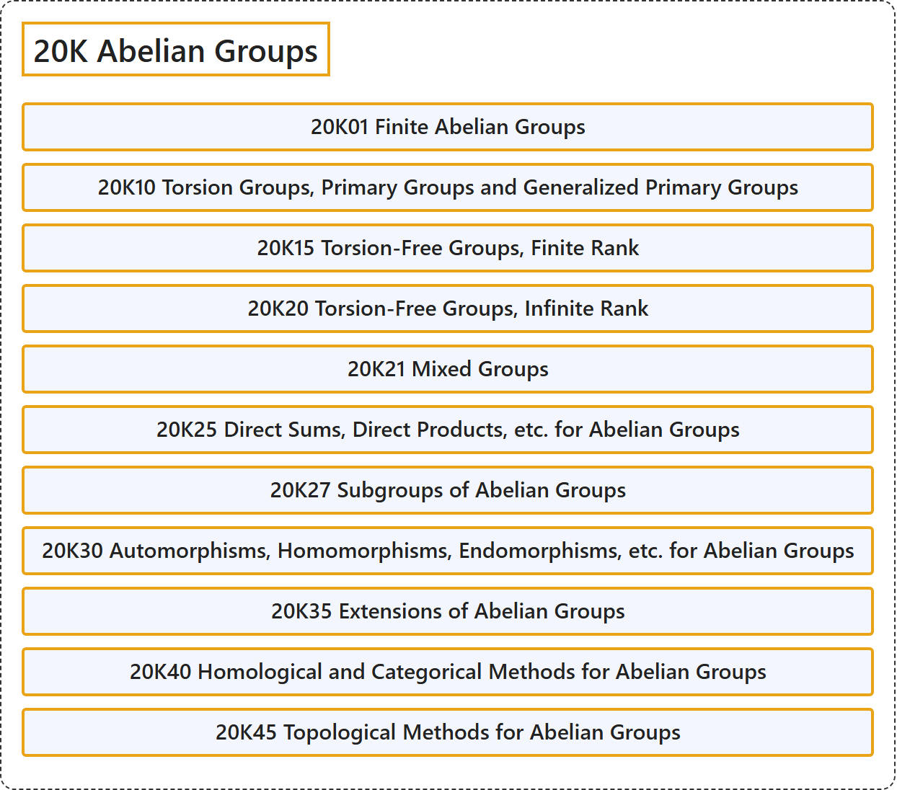

# 20K Abelian Groups

## Classification

## Glossary

| Term | Definition | 中文翻译 | Source |
|---|---|---|---|
| **20K Abelian Groups** 阿贝尔群 | (No definition) | （无定义） | [Associate Editors of Mathematical Reviews and zbMATH, 2020](https://msc2020.org/) |
| **20K01 Finite Abelian Groups** 有限阿贝尔群 | (No definition) | （无定义） | [Associate Editors of Mathematical Reviews and zbMATH, 2020](https://msc2020.org/) |
| **20K10 Torsion Groups, Primary Groups and Generalized Primary Groups** 挠群、准素群与广义准素群 | (No definition) | （无定义） | [Associate Editors of Mathematical Reviews and zbMATH, 2020](https://msc2020.org/) |
| **20K15 Torsion-Free Groups, Finite Rank** 无挠群、有限秩 | (No definition) | （无定义） | [Associate Editors of Mathematical Reviews and zbMATH, 2020](https://msc2020.org/) |
| **20K20 Torsion-Free Groups, Infinite Rank** 无挠群、无限秩 | (No definition) | （无定义） | [Associate Editors of Mathematical Reviews and zbMATH, 2020](https://msc2020.org/) |
| **20K21 Mixed Groups** 混合群 | (No definition) | （无定义） | [Associate Editors of Mathematical Reviews and zbMATH, 2020](https://msc2020.org/) |
| **20K25 Direct Sums, Direct Products, etc. for Abelian Groups** 阿贝尔群的直和、直积等 | (No definition) | （无定义） | [Associate Editors of Mathematical Reviews and zbMATH, 2020](https://msc2020.org/) |
| **20K27 Subgroups of Abelian Groups** 阿贝尔群的子群 | (No definition) | （无定义） | [Associate Editors of Mathematical Reviews and zbMATH, 2020](https://msc2020.org/) |
| **20K30 Automorphisms, Homomorphisms, Endomorphisms, etc. for Abelian Groups** 阿贝尔群的自同构、同态、自同态等 | (No definition) | （无定义） | [Associate Editors of Mathematical Reviews and zbMATH, 2020](https://msc2020.org/) |
| **20K35 Extensions of Abelian Groups** 阿贝尔群的扩张 | (No definition) | （无定义） | [Associate Editors of Mathematical Reviews and zbMATH, 2020](https://msc2020.org/) |
| **20K40 Homological and Categorical Methods for Abelian Groups** 阿贝尔群的同调方法与范畴方法 | (No definition) | （无定义） | [Associate Editors of Mathematical Reviews and zbMATH, 2020](https://msc2020.org/) |
| **20K45 Topological Methods for Abelian Groups** 阿贝尔群的拓扑方法 | (No definition) | （无定义） | [Associate Editors of Mathematical Reviews and zbMATH, 2020](https://msc2020.org/) |

## References

Associate Editors of Mathematical Reviews and zbMATH. (2020). *MSC2020: Mathematics Subject Classification system*. Retrieved October 27, 2026, from <https://msc2020.org/>
