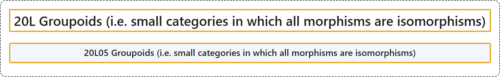

# 20L Groupoids (i.e. small categories in which all morphisms are isomorphisms)

## Classification

## Glossary

| Term | Definition | 中文翻译 | Source |
|---|---|---|---|
| **20L Groupoids (i.e. small categories in which all morphisms are isomorphisms)** 广群（即所有态射均为同构的小范畴） | (No definition) | （无定义） | [Associate Editors of Mathematical Reviews and zbMATH, 2020](https://msc2020.org/) |
| **20L05 Groupoids (i.e. small categories in which all morphisms are isomorphisms)** 广群（即所有态射均为同构的小范畴） | (No definition) | （无定义） | [Associate Editors of Mathematical Reviews and zbMATH, 2020](https://msc2020.org/) |

## References

Associate Editors of Mathematical Reviews and zbMATH. (2020). *MSC2020: Mathematics Subject Classification system*. Retrieved October 27, 2026, from <https://msc2020.org/>
