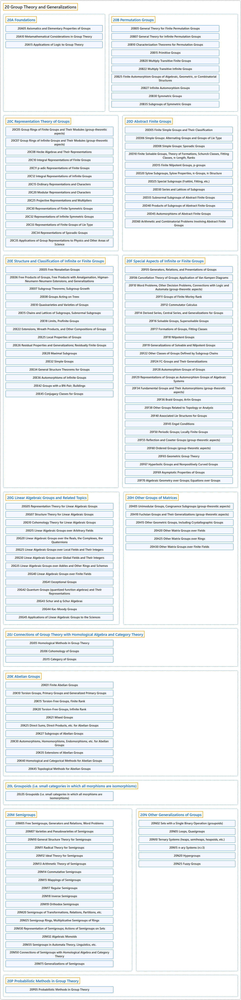

# 20 Group Theory and Generalizations

## Classification

## Glossary

| Term | Definition | 中文翻译 | Source |
|---|---|---|---|
| **20 Group Theory and Generalizations** 群论及其推广 | "The **study of groups**." | 对**群的研究**。 | [Weisstein, n.d., "Group theory" entry, para. 1](https://mathworld.wolfram.com/GroupTheory.html#:~:text=The%20study%20of%20groups) |
| **[20A Foundations](20a-foundations.md)** 基础 | (No definition) | （无定义） | [Associate Editors of Mathematical Reviews and zbMATH, 2020](https://msc2020.org/) |
| **[20B Permutation Groups](20b-permutation-groups.md)** 置换群 | (No definition) | （无定义） | [Associate Editors of Mathematical Reviews and zbMATH, 2020](https://msc2020.org/) |
| **[20C Representation Theory of Groups](20c-representation-theory-of-groups.md)** 群的表示论 | (No definition) | （无定义） | [Associate Editors of Mathematical Reviews and zbMATH, 2020](https://msc2020.org/) |
| **[20D Abstract Finite Groups](20d-abstract-finite-groups.md)** 抽象有限群 | (No definition) | （无定义） | [Associate Editors of Mathematical Reviews and zbMATH, 2020](https://msc2020.org/) |
| **[20E Structure and Classification of Infinite or Finite Groups](20e-structure-and-classification-of-infinite-or-finite-groups.md)** 无限群或有限群的结构与分类 | (No definition) | （无定义） | [Associate Editors of Mathematical Reviews and zbMATH, 2020](https://msc2020.org/) |
| **[20F Special Aspects of Infinite or Finite Groups](20f-special-aspects-of-infinite-or-finite-groups.md)** 无限群或有限群的特殊方面 | (No definition) | （无定义） | [Associate Editors of Mathematical Reviews and zbMATH, 2020](https://msc2020.org/) |
| **[20G Linear Algebraic Groups and Related Topics](20g-linear-algebraic-groups-and-related-topics.md)** 线性代数群及相关专题 | (No definition) | （无定义） | [Associate Editors of Mathematical Reviews and zbMATH, 2020](https://msc2020.org/) |
| **[20H Other Groups of Matrices](20h-other-groups-of-matrices.md)** 其他矩阵群 | (No definition) | （无定义） | [Associate Editors of Mathematical Reviews and zbMATH, 2020](https://msc2020.org/) |
| **[20J Connections of Group Theory with Homological Algebra and Category Theory](20j-connections-of-group-theory-with-homological-algebra-and-cat.md)** 群论与同调代数及范畴论的联系 | (No definition) | （无定义） | [Associate Editors of Mathematical Reviews and zbMATH, 2020](https://msc2020.org/) |
| **[20K Abelian Groups](20k-abelian-groups.md)** 阿贝尔群 | (No definition) | （无定义） | [Associate Editors of Mathematical Reviews and zbMATH, 2020](https://msc2020.org/) |
| **[20L Groupoids (i.e. small categories in which all morphisms are isomorphisms)](20l-groupoids-i-e-small-categories-in-which-all-morphisms-are-is.md)** 广群（即所有态射均为同构的小范畴） | (No definition) | （无定义） | [Associate Editors of Mathematical Reviews and zbMATH, 2020](https://msc2020.org/) |
| **[20M Semigroups](20m-semigroups.md)** 半群 | (No definition) | （无定义） | [Associate Editors of Mathematical Reviews and zbMATH, 2020](https://msc2020.org/) |
| **[20N Other Generalizations of Groups](20n-other-generalizations-of-groups.md)** 群的其他推广 | (No definition) | （无定义） | [Associate Editors of Mathematical Reviews and zbMATH, 2020](https://msc2020.org/) |
| **[20P Probabilistic Methods in Group Theory](20p-probabilistic-methods-in-group-theory.md)** 群论中的概率方法 | (No definition) | （无定义） | [Associate Editors of Mathematical Reviews and zbMATH, 2020](https://msc2020.org/) |

## References

Associate Editors of Mathematical Reviews and zbMATH. (2020). *MSC2020: Mathematics Subject Classification system*. Retrieved October 27, 2026, from <https://msc2020.org/>

Weisstein, E. W. (n.d.). *Group theory*. MathWorld: A Wolfram Resource. Retrieved October 27, 2026, from <https://mathworld.wolfram.com/GroupTheory.html>
