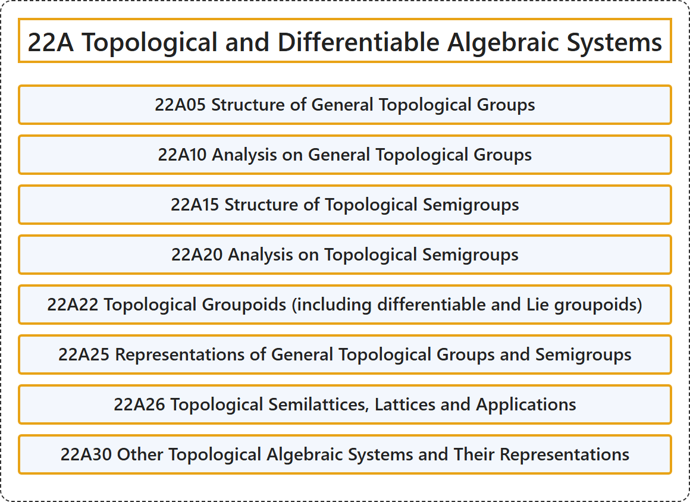

# 22A Topological and Differentiable Algebraic Systems

## Classification

## Glossary

| Term | Definition | 中文翻译 | Source |
|---|---|---|---|
| **22A Topological and Differentiable Algebraic Systems** 拓扑与可微代数系统 | (No definition) | （无定义） | [Associate Editors of Mathematical Reviews and zbMATH, 2020](https://msc2020.org/) |
| **22A05 Structure of General Topological Groups** 一般拓扑群的结构 | (No definition) | （无定义） | [Associate Editors of Mathematical Reviews and zbMATH, 2020](https://msc2020.org/) |
| **22A10 Analysis on General Topological Groups** 一般拓扑群上的分析 | (No definition) | （无定义） | [Associate Editors of Mathematical Reviews and zbMATH, 2020](https://msc2020.org/) |
| **22A15 Structure of Topological Semigroups** 拓扑半群的结构 | (No definition) | （无定义） | [Associate Editors of Mathematical Reviews and zbMATH, 2020](https://msc2020.org/) |
| **22A20 Analysis on Topological Semigroups** 拓扑半群上的分析 | (No definition) | （无定义） | [Associate Editors of Mathematical Reviews and zbMATH, 2020](https://msc2020.org/) |
| **22A22 Topological Groupoids (including differentiable and Lie groupoids)** 拓扑广群（包括可微广群与李广群） | (No definition) | （无定义） | [Associate Editors of Mathematical Reviews and zbMATH, 2020](https://msc2020.org/) |
| **22A25 Representations of General Topological Groups and Semigroups** 一般拓扑群与半群的表示 | (No definition) | （无定义） | [Associate Editors of Mathematical Reviews and zbMATH, 2020](https://msc2020.org/) |
| **22A26 Topological Semilattices, Lattices and Applications** 拓扑半格、格及其应用 | (No definition) | （无定义） | [Associate Editors of Mathematical Reviews and zbMATH, 2020](https://msc2020.org/) |
| **22A30 Other Topological Algebraic Systems and Their Representations** 其他拓扑代数系统及其表示 | (No definition) | （无定义） | [Associate Editors of Mathematical Reviews and zbMATH, 2020](https://msc2020.org/) |

## References

Associate Editors of Mathematical Reviews and zbMATH. (2020). *MSC2020: Mathematics Subject Classification system*. Retrieved October 27, 2026, from <https://msc2020.org/>
