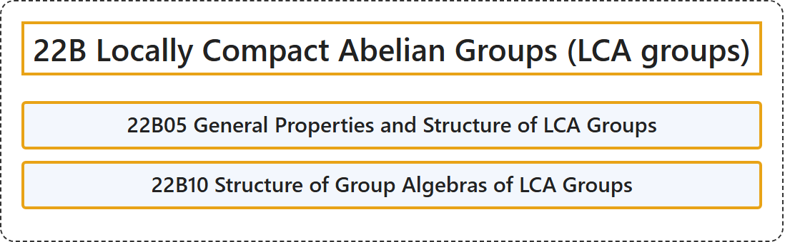

# 22B Locally Compact Abelian Groups (LCA groups)

## Classification

## Glossary

| Term | Definition | 中文翻译 | Source |
|---|---|---|---|
| **22B Locally Compact Abelian Groups (LCA groups)** 局部紧阿贝尔群（LCA 群） | (No definition) | （无定义） | [Associate Editors of Mathematical Reviews and zbMATH, 2020](https://msc2020.org/) |
| **22B05 General Properties and Structure of LCA Groups** 局部紧交换群的一般性质与结构 | (No definition) | （无定义） | [Associate Editors of Mathematical Reviews and zbMATH, 2020](https://msc2020.org/) |
| **22B10 Structure of Group Algebras of LCA Groups** 局部紧交换群的群代数的结构 | (No definition) | （无定义） | [Associate Editors of Mathematical Reviews and zbMATH, 2020](https://msc2020.org/) |

## References

Associate Editors of Mathematical Reviews and zbMATH. (2020). *MSC2020: Mathematics Subject Classification system*. Retrieved October 27, 2026, from <https://msc2020.org/>
