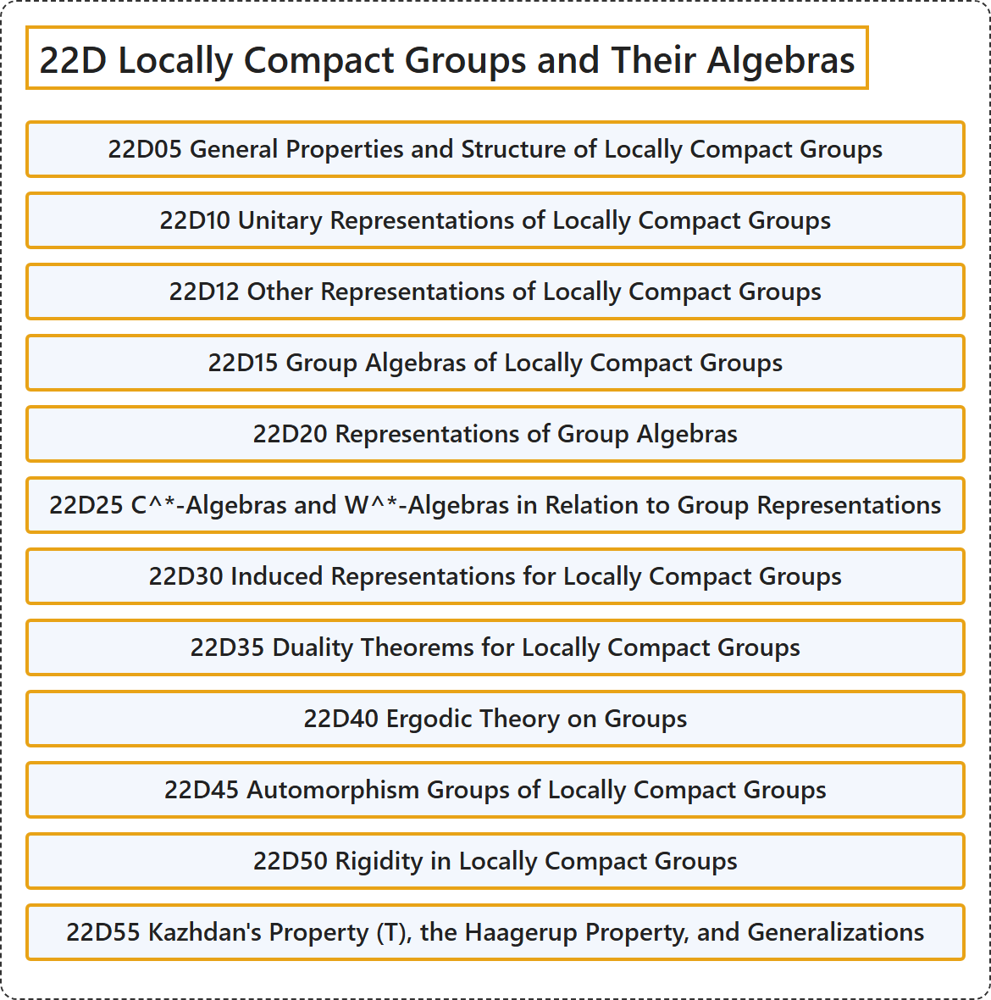

# 22D Locally Compact Groups and Their Algebras

## Classification

## Glossary

| Term | Definition | 中文翻译 | Source |
|---|---|---|---|
| **22D Locally Compact Groups and Their Algebras** 局部紧群及其代数 | (No definition) | （无定义） | [Associate Editors of Mathematical Reviews and zbMATH, 2020](https://msc2020.org/) |
| **22D05 General Properties and Structure of Locally Compact Groups** 局部紧群的一般性质与结构 | (No definition) | （无定义） | [Associate Editors of Mathematical Reviews and zbMATH, 2020](https://msc2020.org/) |
| **22D10 Unitary Representations of Locally Compact Groups** 局部紧群的酉表示 | (No definition) | （无定义） | [Associate Editors of Mathematical Reviews and zbMATH, 2020](https://msc2020.org/) |
| **22D12 Other Representations of Locally Compact Groups** 局部紧群的其他表示 | (No definition) | （无定义） | [Associate Editors of Mathematical Reviews and zbMATH, 2020](https://msc2020.org/) |
| **22D15 Group Algebras of Locally Compact Groups** 局部紧群的群代数 | (No definition) | （无定义） | [Associate Editors of Mathematical Reviews and zbMATH, 2020](https://msc2020.org/) |
| **22D20 Representations of Group Algebras** 群代数的表示 | (No definition) | （无定义） | [Associate Editors of Mathematical Reviews and zbMATH, 2020](https://msc2020.org/) |
| **22D25 C^\*-Algebras and W^\*-Algebras in Relation to Group Representations** 与群表示相关的C^*代数与W^*代数 | (No definition) | （无定义） | [Associate Editors of Mathematical Reviews and zbMATH, 2020](https://msc2020.org/) |
| **22D30 Induced Representations for Locally Compact Groups** 局部紧群的诱导表示 | (No definition) | （无定义） | [Associate Editors of Mathematical Reviews and zbMATH, 2020](https://msc2020.org/) |
| **22D35 Duality Theorems for Locally Compact Groups** 局部紧群的对偶定理 | (No definition) | （无定义） | [Associate Editors of Mathematical Reviews and zbMATH, 2020](https://msc2020.org/) |
| **22D40 Ergodic Theory on Groups** 群上的遍历理论 | (No definition) | （无定义） | [Associate Editors of Mathematical Reviews and zbMATH, 2020](https://msc2020.org/) |
| **22D45 Automorphism Groups of Locally Compact Groups** 局部紧群的自同构群 | (No definition) | （无定义） | [Associate Editors of Mathematical Reviews and zbMATH, 2020](https://msc2020.org/) |
| **22D50 Rigidity in Locally Compact Groups** 局部紧群中的刚性 | (No definition) | （无定义） | [Associate Editors of Mathematical Reviews and zbMATH, 2020](https://msc2020.org/) |
| **22D55 Kazhdan's Property (T), the Haagerup Property, and Generalizations** 卡兹丹性质（T）、哈格鲁普性质及其推广 | (No definition) | （无定义） | [Associate Editors of Mathematical Reviews and zbMATH, 2020](https://msc2020.org/) |

## References

Associate Editors of Mathematical Reviews and zbMATH. (2020). *MSC2020: Mathematics Subject Classification system*. Retrieved October 27, 2026, from <https://msc2020.org/>
