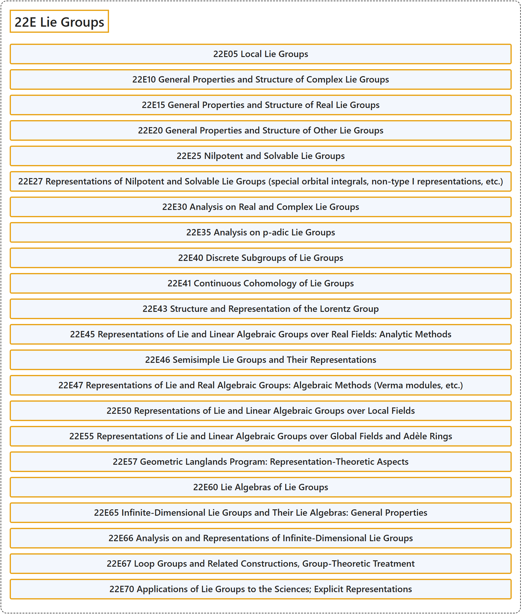

# 22E Lie Groups

## Classification

## Glossary

| Term | Definition | 中文翻译 | Source |
|---|---|---|---|
| **22E Lie Groups** 李群 | (No definition) | （无定义） | [Associate Editors of Mathematical Reviews and zbMATH, 2020](https://msc2020.org/) |
| **22E05 Local Lie Groups** 局部李群 | (No definition) | （无定义） | [Associate Editors of Mathematical Reviews and zbMATH, 2020](https://msc2020.org/) |
| **22E10 General Properties and Structure of Complex Lie Groups** 复李群的一般性质与结构 | (No definition) | （无定义） | [Associate Editors of Mathematical Reviews and zbMATH, 2020](https://msc2020.org/) |
| **22E15 General Properties and Structure of Real Lie Groups** 实李群的一般性质与结构 | (No definition) | （无定义） | [Associate Editors of Mathematical Reviews and zbMATH, 2020](https://msc2020.org/) |
| **22E20 General Properties and Structure of Other Lie Groups** 其他李群的一般性质与结构 | (No definition) | （无定义） | [Associate Editors of Mathematical Reviews and zbMATH, 2020](https://msc2020.org/) |
| **22E25 Nilpotent and Solvable Lie Groups** 幂零李群与可解李群 | (No definition) | （无定义） | [Associate Editors of Mathematical Reviews and zbMATH, 2020](https://msc2020.org/) |
| **22E27 Representations of Nilpotent and Solvable Lie Groups (special orbital integrals, non-type I representations, etc.)** 幂零李群与可解李群的表示（特殊轨道积分、非I型表示等） | (No definition) | （无定义） | [Associate Editors of Mathematical Reviews and zbMATH, 2020](https://msc2020.org/) |
| **22E30 Analysis on Real and Complex Lie Groups** 实李群与复李群上的分析 | (No definition) | （无定义） | [Associate Editors of Mathematical Reviews and zbMATH, 2020](https://msc2020.org/) |
| **22E35 Analysis on p-adic Lie Groups** p进李群上的分析 | (No definition) | （无定义） | [Associate Editors of Mathematical Reviews and zbMATH, 2020](https://msc2020.org/) |
| **22E40 Discrete Subgroups of Lie Groups** 李群的离散子群 | (No definition) | （无定义） | [Associate Editors of Mathematical Reviews and zbMATH, 2020](https://msc2020.org/) |
| **22E41 Continuous Cohomology of Lie Groups** 李群的连续上同调 | (No definition) | （无定义） | [Associate Editors of Mathematical Reviews and zbMATH, 2020](https://msc2020.org/) |
| **22E43 Structure and Representation of the Lorentz Group** 洛伦兹群的结构与表示 | (No definition) | （无定义） | [Associate Editors of Mathematical Reviews and zbMATH, 2020](https://msc2020.org/) |
| **22E45 Representations of Lie and Linear Algebraic Groups over Real Fields: Analytic Methods** 实域上李群与线性代数群的表示：解析方法 | (No definition) | （无定义） | [Associate Editors of Mathematical Reviews and zbMATH, 2020](https://msc2020.org/) |
| **22E46 Semisimple Lie Groups and Their Representations** 半单李群及其表示 | (No definition) | （无定义） | [Associate Editors of Mathematical Reviews and zbMATH, 2020](https://msc2020.org/) |
| **22E47 Representations of Lie and Real Algebraic Groups: Algebraic Methods (Verma modules, etc.)** 李群与实代数群的表示：代数方法（韦尔玛模等） | (No definition) | （无定义） | [Associate Editors of Mathematical Reviews and zbMATH, 2020](https://msc2020.org/) |
| **22E50 Representations of Lie and Linear Algebraic Groups over Local Fields** 局部域上李群与线性代数群的表示 | (No definition) | （无定义） | [Associate Editors of Mathematical Reviews and zbMATH, 2020](https://msc2020.org/) |
| **22E55 Representations of Lie and Linear Algebraic Groups over Global Fields and Adèle Rings** 整体域与阿代尔环上李群与线性代数群的表示 | (No definition) | （无定义） | [Associate Editors of Mathematical Reviews and zbMATH, 2020](https://msc2020.org/) |
| **22E57 Geometric Langlands Program: Representation-Theoretic Aspects** 几何朗兰兹纲领：表示论方面 | (No definition) | （无定义） | [Associate Editors of Mathematical Reviews and zbMATH, 2020](https://msc2020.org/) |
| **22E60 Lie Algebras of Lie Groups** 李群的李代数 | (No definition) | （无定义） | [Associate Editors of Mathematical Reviews and zbMATH, 2020](https://msc2020.org/) |
| **22E65 Infinite-Dimensional Lie Groups and Their Lie Algebras: General Properties** 无限维李群及其李代数：一般性质 | (No definition) | （无定义） | [Associate Editors of Mathematical Reviews and zbMATH, 2020](https://msc2020.org/) |
| **22E66 Analysis on and Representations of Infinite-Dimensional Lie Groups** 无限维李群上的分析及其表示 | (No definition) | （无定义） | [Associate Editors of Mathematical Reviews and zbMATH, 2020](https://msc2020.org/) |
| **22E67 Loop Groups and Related Constructions, Group-Theoretic Treatment** 圈群及相关构造、群论处理 | (No definition) | （无定义） | [Associate Editors of Mathematical Reviews and zbMATH, 2020](https://msc2020.org/) |
| **22E70 Applications of Lie Groups to the Sciences; Explicit Representations** 李群在科学中的应用；显式表示 | (No definition) | （无定义） | [Associate Editors of Mathematical Reviews and zbMATH, 2020](https://msc2020.org/) |

## References

Associate Editors of Mathematical Reviews and zbMATH. (2020). *MSC2020: Mathematics Subject Classification system*. Retrieved October 27, 2026, from <https://msc2020.org/>
