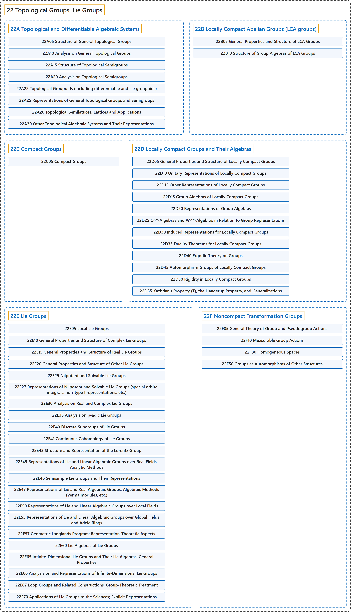

# 22 Topological Groups, Lie Groups

## Classification

## Glossary

| Term | Definition | 中文翻译 | Source |
|---|---|---|---|
| **22 Topological Groups, Lie Groups** 拓扑群、李群 | "A topological group is a **continuous group** G which has the **topology of a T2-space**." | 拓扑群是具有 **T2 空间拓扑**的**连续群** G。 | [Weisstein, n.d., "Topological group" entry, para. 1](https://mathworld.wolfram.com/TopologicalGroup.html#:~:text=A%20topological%20group%20is%20a%20continuous%20group) |
| **[22A Topological and Differentiable Algebraic Systems](22a-topological-and-differentiable-algebraic-systems.md)** 拓扑与可微代数系统 | (No definition) | （无定义） | [Associate Editors of Mathematical Reviews and zbMATH, 2020](https://msc2020.org/) |
| **[22B Locally Compact Abelian Groups (LCA groups)](22b-locally-compact-abelian-groups-lca-groups.md)** 局部紧阿贝尔群（LCA 群） | (No definition) | （无定义） | [Associate Editors of Mathematical Reviews and zbMATH, 2020](https://msc2020.org/) |
| **[22C Compact Groups](22c-compact-groups.md)** 紧群 | (No definition) | （无定义） | [Associate Editors of Mathematical Reviews and zbMATH, 2020](https://msc2020.org/) |
| **[22D Locally Compact Groups and Their Algebras](22d-locally-compact-groups-and-their-algebras.md)** 局部紧群及其代数 | (No definition) | （无定义） | [Associate Editors of Mathematical Reviews and zbMATH, 2020](https://msc2020.org/) |
| **[22E Lie Groups](22e-lie-groups.md)** 李群 | (No definition) | （无定义） | [Associate Editors of Mathematical Reviews and zbMATH, 2020](https://msc2020.org/) |
| **[22F Noncompact Transformation Groups](22f-noncompact-transformation-groups.md)** 非紧变换群 | (No definition) | （无定义） | [Associate Editors of Mathematical Reviews and zbMATH, 2020](https://msc2020.org/) |

## References

Associate Editors of Mathematical Reviews and zbMATH. (2020). *MSC2020: Mathematics Subject Classification system*. Retrieved October 27, 2026, from <https://msc2020.org/>

Weisstein, E. W. (n.d.). *Topological group*. MathWorld: A Wolfram Resource. Retrieved October 27, 2026, from <https://mathworld.wolfram.com/TopologicalGroup.html>
