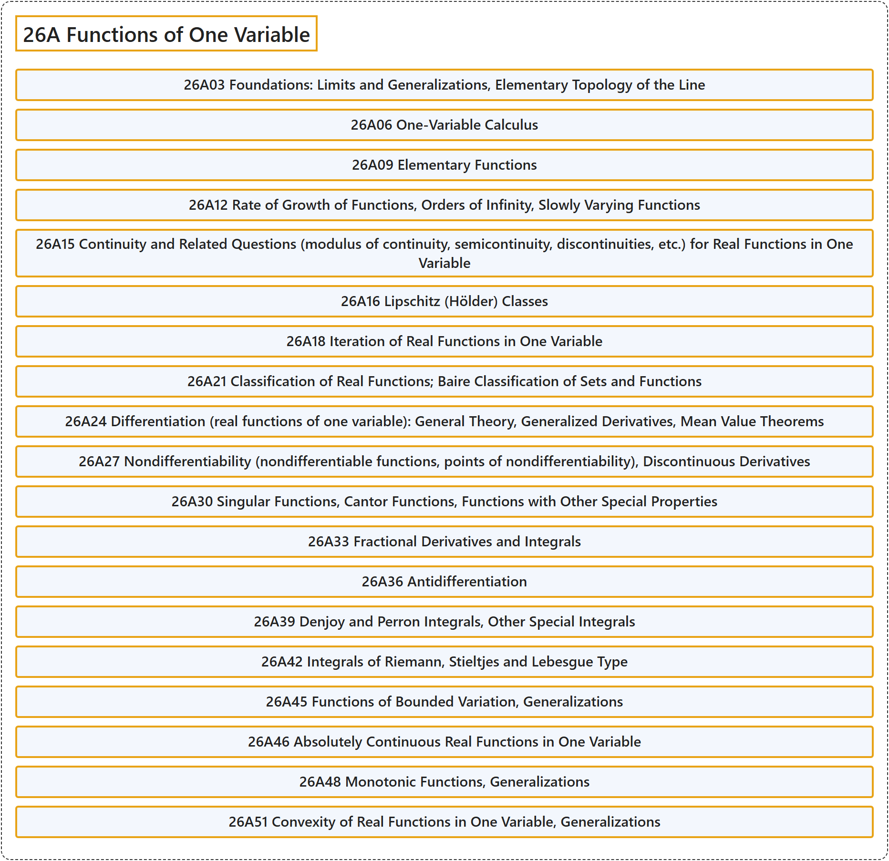

# 26A Functions of One Variable

## Classification

## Glossary

| Term | Definition | 中文翻译 | Source |
|---|---|---|---|
| **26A Functions of One Variable** 一元函数 | (No definition) | （无定义） | [Associate Editors of Mathematical Reviews and zbMATH, 2020](https://msc2020.org/) |
| **26A03 Foundations: Limits and Generalizations, Elementary Topology of the Line** 基础：极限及其推广、直线的初等拓扑 | (No definition) | （无定义） | [Associate Editors of Mathematical Reviews and zbMATH, 2020](https://msc2020.org/) |
| **26A06 One-Variable Calculus** 一元微积分 | (No definition) | （无定义） | [Associate Editors of Mathematical Reviews and zbMATH, 2020](https://msc2020.org/) |
| **26A09 Elementary Functions** 初等函数 | (No definition) | （无定义） | [Associate Editors of Mathematical Reviews and zbMATH, 2020](https://msc2020.org/) |
| **26A12 Rate of Growth of Functions, Orders of Infinity, Slowly Varying Functions** 函数的增长率、无穷大的阶、慢变函数 | (No definition) | （无定义） | [Associate Editors of Mathematical Reviews and zbMATH, 2020](https://msc2020.org/) |
| **26A15 Continuity and Related Questions (modulus of continuity, semicontinuity, discontinuities, etc.) for Real Functions in One Variable** 一元实函数的连续性及相关问题（连续模、半连续性、间断点等） | (No definition) | （无定义） | [Associate Editors of Mathematical Reviews and zbMATH, 2020](https://msc2020.org/) |
| **26A16 Lipschitz (Hölder) Classes** 利普希茨（赫尔德）类 | (No definition) | （无定义） | [Associate Editors of Mathematical Reviews and zbMATH, 2020](https://msc2020.org/) |
| **26A18 Iteration of Real Functions in One Variable** 一元实函数的迭代 | (No definition) | （无定义） | [Associate Editors of Mathematical Reviews and zbMATH, 2020](https://msc2020.org/) |
| **26A21 Classification of Real Functions; Baire Classification of Sets and Functions** 实函数的分类；集合与函数的贝尔分类 | (No definition) | （无定义） | [Associate Editors of Mathematical Reviews and zbMATH, 2020](https://msc2020.org/) |
| **26A24 Differentiation (real functions of one variable): General Theory, Generalized Derivatives, Mean Value Theorems** 微分（一元实函数）：一般理论、广义导数、中值定理 | (No definition) | （无定义） | [Associate Editors of Mathematical Reviews and zbMATH, 2020](https://msc2020.org/) |
| **26A27 Nondifferentiability (nondifferentiable functions, points of nondifferentiability), Discontinuous Derivatives** 不可微性（不可微函数、不可微点）、不连续导数 | (No definition) | （无定义） | [Associate Editors of Mathematical Reviews and zbMATH, 2020](https://msc2020.org/) |
| **26A30 Singular Functions, Cantor Functions, Functions with Other Special Properties** 奇异函数、康托函数、具有其他特殊性质的函数 | (No definition) | （无定义） | [Associate Editors of Mathematical Reviews and zbMATH, 2020](https://msc2020.org/) |
| **26A33 Fractional Derivatives and Integrals** 分数阶导数与积分 | (No definition) | （无定义） | [Associate Editors of Mathematical Reviews and zbMATH, 2020](https://msc2020.org/) |
| **26A36 Antidifferentiation** 反微分 | (No definition) | （无定义） | [Associate Editors of Mathematical Reviews and zbMATH, 2020](https://msc2020.org/) |
| **26A39 Denjoy and Perron Integrals, Other Special Integrals** 当茹瓦积分与佩龙积分、其他特殊积分 | (No definition) | （无定义） | [Associate Editors of Mathematical Reviews and zbMATH, 2020](https://msc2020.org/) |
| **26A42 Integrals of Riemann, Stieltjes and Lebesgue Type** 黎曼型、斯蒂尔杰斯型与勒贝格型积分 | (No definition) | （无定义） | [Associate Editors of Mathematical Reviews and zbMATH, 2020](https://msc2020.org/) |
| **26A45 Functions of Bounded Variation, Generalizations** 有界变差函数、推广 | (No definition) | （无定义） | [Associate Editors of Mathematical Reviews and zbMATH, 2020](https://msc2020.org/) |
| **26A46 Absolutely Continuous Real Functions in One Variable** 一元绝对连续实函数 | (No definition) | （无定义） | [Associate Editors of Mathematical Reviews and zbMATH, 2020](https://msc2020.org/) |
| **26A48 Monotonic Functions, Generalizations** 单调函数、推广 | (No definition) | （无定义） | [Associate Editors of Mathematical Reviews and zbMATH, 2020](https://msc2020.org/) |
| **26A51 Convexity of Real Functions in One Variable, Generalizations** 一元实函数的凸性、推广 | (No definition) | （无定义） | [Associate Editors of Mathematical Reviews and zbMATH, 2020](https://msc2020.org/) |

## References

Associate Editors of Mathematical Reviews and zbMATH. (2020). *MSC2020: Mathematics Subject Classification system*. Retrieved October 27, 2026, from <https://msc2020.org/>
