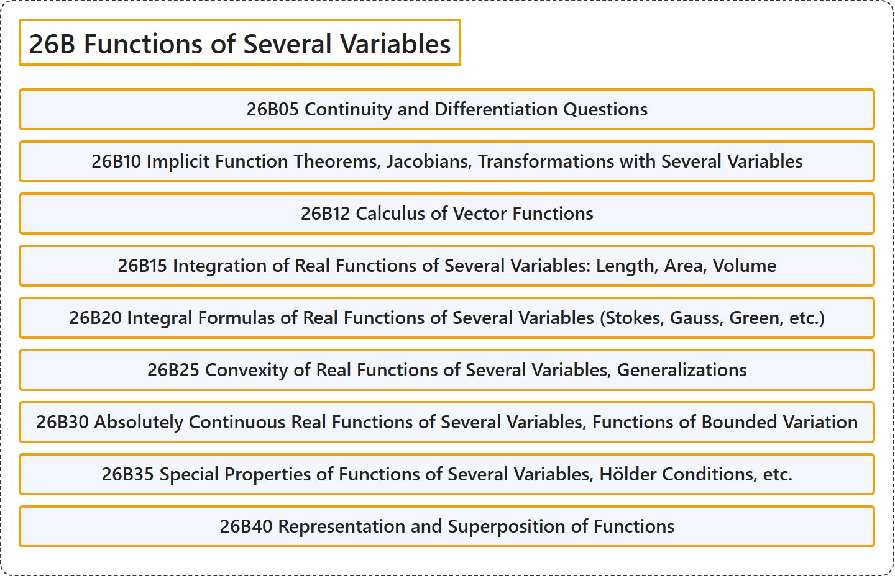

# 26B Functions of Several Variables

## Classification

## Glossary

| Term | Definition | 中文翻译 | Source |
|---|---|---|---|
| **26B Functions of Several Variables** 多元函数 | (No definition) | （无定义） | [Associate Editors of Mathematical Reviews and zbMATH, 2020](https://msc2020.org/) |
| **26B05 Continuity and Differentiation Questions** 连续性与微分问题 | (No definition) | （无定义） | [Associate Editors of Mathematical Reviews and zbMATH, 2020](https://msc2020.org/) |
| **26B10 Implicit Function Theorems, Jacobians, Transformations with Several Variables** 隐函数定理、雅可比行列式、多变量变换 | (No definition) | （无定义） | [Associate Editors of Mathematical Reviews and zbMATH, 2020](https://msc2020.org/) |
| **26B12 Calculus of Vector Functions** 向量函数的微积分 | (No definition) | （无定义） | [Associate Editors of Mathematical Reviews and zbMATH, 2020](https://msc2020.org/) |
| **26B15 Integration of Real Functions of Several Variables: Length, Area, Volume** 多元实函数的积分：长度、面积、体积 | (No definition) | （无定义） | [Associate Editors of Mathematical Reviews and zbMATH, 2020](https://msc2020.org/) |
| **26B20 Integral Formulas of Real Functions of Several Variables (Stokes, Gauss, Green, etc.)** 多元实函数的积分公式（斯托克斯、高斯、格林等） | (No definition) | （无定义） | [Associate Editors of Mathematical Reviews and zbMATH, 2020](https://msc2020.org/) |
| **26B25 Convexity of Real Functions of Several Variables, Generalizations** 多元实函数的凸性、推广 | (No definition) | （无定义） | [Associate Editors of Mathematical Reviews and zbMATH, 2020](https://msc2020.org/) |
| **26B30 Absolutely Continuous Real Functions of Several Variables, Functions of Bounded Variation** 多元绝对连续实函数、有界变差函数 | (No definition) | （无定义） | [Associate Editors of Mathematical Reviews and zbMATH, 2020](https://msc2020.org/) |
| **26B35 Special Properties of Functions of Several Variables, Hölder Conditions, etc.** 多元函数的特殊性质、赫尔德条件等 | (No definition) | （无定义） | [Associate Editors of Mathematical Reviews and zbMATH, 2020](https://msc2020.org/) |
| **26B40 Representation and Superposition of Functions** 函数的表示与叠加 | (No definition) | （无定义） | [Associate Editors of Mathematical Reviews and zbMATH, 2020](https://msc2020.org/) |

## References

Associate Editors of Mathematical Reviews and zbMATH. (2020). *MSC2020: Mathematics Subject Classification system*. Retrieved October 27, 2026, from <https://msc2020.org/>
