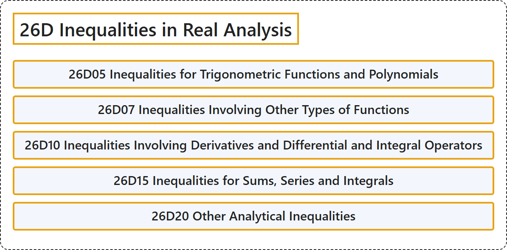

# 26D Inequalities in Real Analysis

## Classification

## Glossary

| Term | Definition | 中文翻译 | Source |
|---|---|---|---|
| **26D Inequalities in Real Analysis** 实分析中的不等式 | (No definition) | （无定义） | [Associate Editors of Mathematical Reviews and zbMATH, 2020](https://msc2020.org/) |
| **26D05 Inequalities for Trigonometric Functions and Polynomials** 三角函数与三角多项式的不等式 | (No definition) | （无定义） | [Associate Editors of Mathematical Reviews and zbMATH, 2020](https://msc2020.org/) |
| **26D07 Inequalities Involving Other Types of Functions** 涉及其他类型函数的不等式 | (No definition) | （无定义） | [Associate Editors of Mathematical Reviews and zbMATH, 2020](https://msc2020.org/) |
| **26D10 Inequalities Involving Derivatives and Differential and Integral Operators** 涉及导数及微分算子与积分算子的不等式 | (No definition) | （无定义） | [Associate Editors of Mathematical Reviews and zbMATH, 2020](https://msc2020.org/) |
| **26D15 Inequalities for Sums, Series and Integrals** 和、级数与积分的不等式 | (No definition) | （无定义） | [Associate Editors of Mathematical Reviews and zbMATH, 2020](https://msc2020.org/) |
| **26D20 Other Analytical Inequalities** 其他分析不等式 | (No definition) | （无定义） | [Associate Editors of Mathematical Reviews and zbMATH, 2020](https://msc2020.org/) |

## References

Associate Editors of Mathematical Reviews and zbMATH. (2020). *MSC2020: Mathematics Subject Classification system*. Retrieved October 27, 2026, from <https://msc2020.org/>
