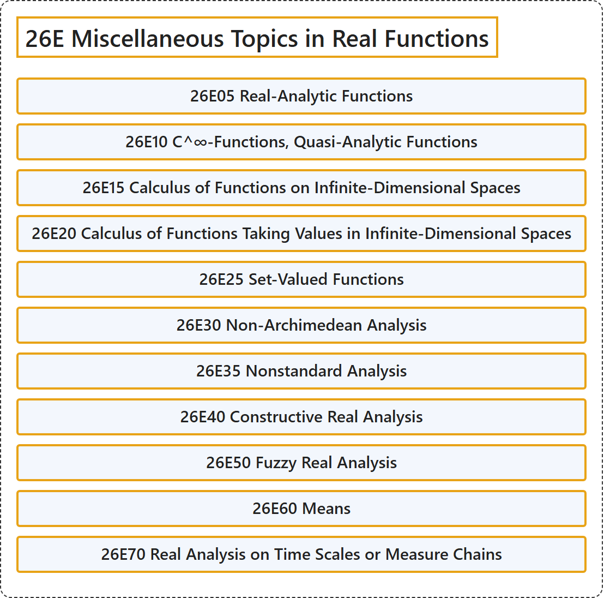

# 26E Miscellaneous Topics in Real Functions

## Classification

## Glossary

| Term | Definition | 中文翻译 | Source |
|---|---|---|---|
| **26E Miscellaneous Topics in Real Functions** 实函数的杂项专题 | (No definition) | （无定义） | [Associate Editors of Mathematical Reviews and zbMATH, 2020](https://msc2020.org/) |
| **26E05 Real-Analytic Functions** 实解析函数 | (No definition) | （无定义） | [Associate Editors of Mathematical Reviews and zbMATH, 2020](https://msc2020.org/) |
| **26E10 C^∞-Functions, Quasi-Analytic Functions** C^∞函数、拟解析函数 | (No definition) | （无定义） | [Associate Editors of Mathematical Reviews and zbMATH, 2020](https://msc2020.org/) |
| **26E15 Calculus of Functions on Infinite-Dimensional Spaces** 无限维空间上函数的微积分 | (No definition) | （无定义） | [Associate Editors of Mathematical Reviews and zbMATH, 2020](https://msc2020.org/) |
| **26E20 Calculus of Functions Taking Values in Infinite-Dimensional Spaces** 取值于无限维空间的函数的微积分 | (No definition) | （无定义） | [Associate Editors of Mathematical Reviews and zbMATH, 2020](https://msc2020.org/) |
| **26E25 Set-Valued Functions** 集值函数 | (No definition) | （无定义） | [Associate Editors of Mathematical Reviews and zbMATH, 2020](https://msc2020.org/) |
| **26E30 Non-Archimedean Analysis** 非阿基米德分析 | (No definition) | （无定义） | [Associate Editors of Mathematical Reviews and zbMATH, 2020](https://msc2020.org/) |
| **26E35 Nonstandard Analysis** 非标准分析 | (No definition) | （无定义） | [Associate Editors of Mathematical Reviews and zbMATH, 2020](https://msc2020.org/) |
| **26E40 Constructive Real Analysis** 构造性实分析 | (No definition) | （无定义） | [Associate Editors of Mathematical Reviews and zbMATH, 2020](https://msc2020.org/) |
| **26E50 Fuzzy Real Analysis** 模糊实分析 | (No definition) | （无定义） | [Associate Editors of Mathematical Reviews and zbMATH, 2020](https://msc2020.org/) |
| **26E60 Means** 平均 | (No definition) | （无定义） | [Associate Editors of Mathematical Reviews and zbMATH, 2020](https://msc2020.org/) |
| **26E70 Real Analysis on Time Scales or Measure Chains** 时标或测度链上的实分析 | (No definition) | （无定义） | [Associate Editors of Mathematical Reviews and zbMATH, 2020](https://msc2020.org/) |

## References

Associate Editors of Mathematical Reviews and zbMATH. (2020). *MSC2020: Mathematics Subject Classification system*. Retrieved October 27, 2026, from <https://msc2020.org/>
