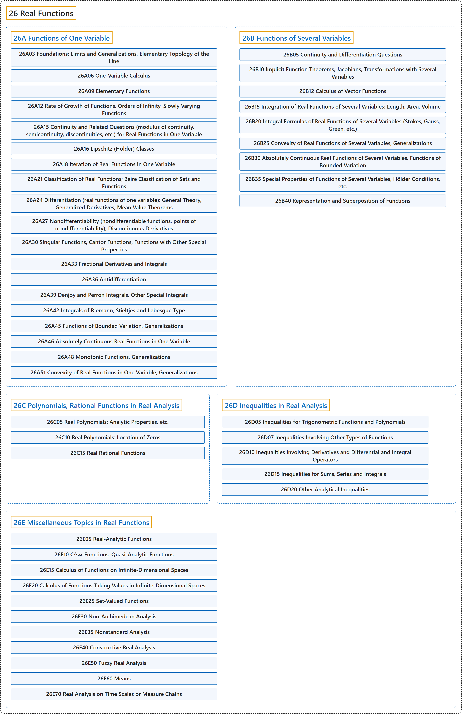

# 26 Real Functions

## Classification

## Glossary

| Term | Definition | 中文翻译 | Source |
|---|---|---|---|
| **26 Real Functions** 实函数 | "A function whose **range is in the real numbers** is said to be a real function, also called a real-valued function." | **值域在实数中**的函数称为实函数，也称为实值函数。 | [Weisstein, n.d., "Real function" entry, para. 1](https://mathworld.wolfram.com/RealFunction.html#:~:text=A%20function%20whose%20range%20is%20in%20the%20real%20numbers) |
| **[26A Functions of One Variable](26a-functions-of-one-variable.md)** 一元函数 | (No definition) | （无定义） | [Associate Editors of Mathematical Reviews and zbMATH, 2020](https://msc2020.org/) |
| **[26B Functions of Several Variables](26b-functions-of-several-variables.md)** 多元函数 | (No definition) | （无定义） | [Associate Editors of Mathematical Reviews and zbMATH, 2020](https://msc2020.org/) |
| **[26C Polynomials, Rational Functions in Real Analysis](26c-polynomials-rational-functions-in-real-analysis.md)** 实分析中的多项式、有理函数 | (No definition) | （无定义） | [Associate Editors of Mathematical Reviews and zbMATH, 2020](https://msc2020.org/) |
| **[26D Inequalities in Real Analysis](26d-inequalities-in-real-analysis.md)** 实分析中的不等式 | (No definition) | （无定义） | [Associate Editors of Mathematical Reviews and zbMATH, 2020](https://msc2020.org/) |
| **[26E Miscellaneous Topics in Real Functions](26e-miscellaneous-topics-in-real-functions.md)** 实函数的杂项专题 | (No definition) | （无定义） | [Associate Editors of Mathematical Reviews and zbMATH, 2020](https://msc2020.org/) |

## References

Associate Editors of Mathematical Reviews and zbMATH. (2020). *MSC2020: Mathematics Subject Classification system*. Retrieved October 27, 2026, from <https://msc2020.org/>

Weisstein, E. W. (n.d.). *Real function*. MathWorld: A Wolfram Resource. Retrieved October 27, 2026, from <https://mathworld.wolfram.com/RealFunction.html>
