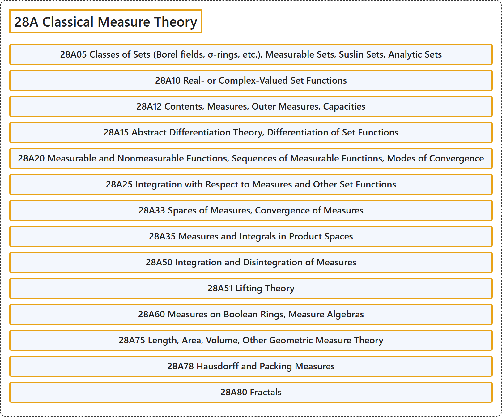

# 28A Classical Measure Theory

## Classification

## Glossary

| Term | Definition | 中文翻译 | Source |
|---|---|---|---|
| **28A Classical Measure Theory** 经典测度论 | (No definition) | （无定义） | [Associate Editors of Mathematical Reviews and zbMATH, 2020](https://msc2020.org/) |
| **28A05 Classes of Sets (Borel fields, σ-rings, etc.), Measurable Sets, Suslin Sets, Analytic Sets** 集类（博雷尔域、σ环等）、可测集、苏斯林集、解析集 | (No definition) | （无定义） | [Associate Editors of Mathematical Reviews and zbMATH, 2020](https://msc2020.org/) |
| **28A10 Real- or Complex-Valued Set Functions** 实值或复值集函数 | (No definition) | （无定义） | [Associate Editors of Mathematical Reviews and zbMATH, 2020](https://msc2020.org/) |
| **28A12 Contents, Measures, Outer Measures, Capacities** 容度、测度、外测度、容量 | (No definition) | （无定义） | [Associate Editors of Mathematical Reviews and zbMATH, 2020](https://msc2020.org/) |
| **28A15 Abstract Differentiation Theory, Differentiation of Set Functions** 抽象微分理论、集函数的微分 | (No definition) | （无定义） | [Associate Editors of Mathematical Reviews and zbMATH, 2020](https://msc2020.org/) |
| **28A20 Measurable and Nonmeasurable Functions, Sequences of Measurable Functions, Modes of Convergence** 可测函数与不可测函数、可测函数序列、收敛方式 | (No definition) | （无定义） | [Associate Editors of Mathematical Reviews and zbMATH, 2020](https://msc2020.org/) |
| **28A25 Integration with Respect to Measures and Other Set Functions** 关于测度及其他集函数的积分 | (No definition) | （无定义） | [Associate Editors of Mathematical Reviews and zbMATH, 2020](https://msc2020.org/) |
| **28A33 Spaces of Measures, Convergence of Measures** 测度空间、测度的收敛 | (No definition) | （无定义） | [Associate Editors of Mathematical Reviews and zbMATH, 2020](https://msc2020.org/) |
| **28A35 Measures and Integrals in Product Spaces** 乘积空间中的测度与积分 | (No definition) | （无定义） | [Associate Editors of Mathematical Reviews and zbMATH, 2020](https://msc2020.org/) |
| **28A50 Integration and Disintegration of Measures** 测度的积分与分解 | (No definition) | （无定义） | [Associate Editors of Mathematical Reviews and zbMATH, 2020](https://msc2020.org/) |
| **28A51 Lifting Theory** 提升理论 | (No definition) | （无定义） | [Associate Editors of Mathematical Reviews and zbMATH, 2020](https://msc2020.org/) |
| **28A60 Measures on Boolean Rings, Measure Algebras** 布尔环上的测度、测度代数 | (No definition) | （无定义） | [Associate Editors of Mathematical Reviews and zbMATH, 2020](https://msc2020.org/) |
| **28A75 Length, Area, Volume, Other Geometric Measure Theory** 长度、面积、体积、其他几何测度论 | (No definition) | （无定义） | [Associate Editors of Mathematical Reviews and zbMATH, 2020](https://msc2020.org/) |
| **28A78 Hausdorff and Packing Measures** 豪斯多夫测度与堆积测度 | (No definition) | （无定义） | [Associate Editors of Mathematical Reviews and zbMATH, 2020](https://msc2020.org/) |
| **28A80 Fractals** 分形 | (No definition) | （无定义） | [Associate Editors of Mathematical Reviews and zbMATH, 2020](https://msc2020.org/) |

## References

Associate Editors of Mathematical Reviews and zbMATH. (2020). *MSC2020: Mathematics Subject Classification system*. Retrieved October 27, 2026, from <https://msc2020.org/>
