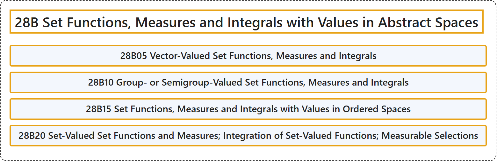

# 28B Set Functions, Measures and Integrals with Values in Abstract Spaces

## Classification

## Glossary

| Term | Definition | 中文翻译 | Source |
|---|---|---|---|
| **28B Set Functions, Measures and Integrals with Values in Abstract Spaces** 取值于抽象空间的集函数、测度与积分 | (No definition) | （无定义） | [Associate Editors of Mathematical Reviews and zbMATH, 2020](https://msc2020.org/) |
| **28B05 Vector-Valued Set Functions, Measures and Integrals** 向量值集函数、测度与积分 | (No definition) | （无定义） | [Associate Editors of Mathematical Reviews and zbMATH, 2020](https://msc2020.org/) |
| **28B10 Group- or Semigroup-Valued Set Functions, Measures and Integrals** 取值于群或半群的集函数、测度与积分 | (No definition) | （无定义） | [Associate Editors of Mathematical Reviews and zbMATH, 2020](https://msc2020.org/) |
| **28B15 Set Functions, Measures and Integrals with Values in Ordered Spaces** 取值于序空间的集函数、测度与积分 | (No definition) | （无定义） | [Associate Editors of Mathematical Reviews and zbMATH, 2020](https://msc2020.org/) |
| **28B20 Set-Valued Set Functions and Measures; Integration of Set-Valued Functions; Measurable Selections** 集值集函数与测度；集值函数的积分；可测选择 | (No definition) | （无定义） | [Associate Editors of Mathematical Reviews and zbMATH, 2020](https://msc2020.org/) |

## References

Associate Editors of Mathematical Reviews and zbMATH. (2020). *MSC2020: Mathematics Subject Classification system*. Retrieved October 27, 2026, from <https://msc2020.org/>
