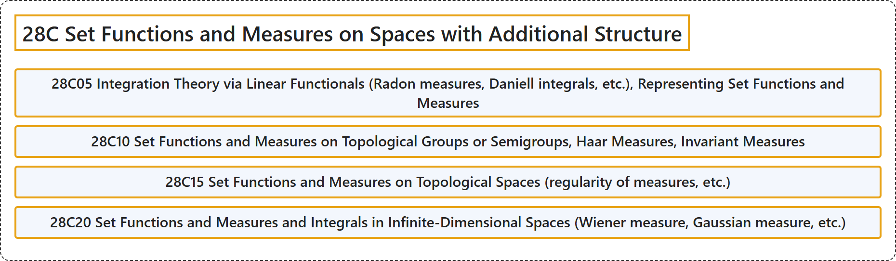

# 28C Set Functions and Measures on Spaces with Additional Structure

## Classification

## Glossary

| Term | Definition | 中文翻译 | Source |
|---|---|---|---|
| **28C Set Functions and Measures on Spaces with Additional Structure** 带附加结构空间上的集函数与测度 | (No definition) | （无定义） | [Associate Editors of Mathematical Reviews and zbMATH, 2020](https://msc2020.org/) |
| **28C05 Integration Theory via Linear Functionals (Radon measures, Daniell integrals, etc.), Representing Set Functions and Measures** 经由线性泛函的积分理论（拉东测度、丹尼尔积分等）、表示集函数与测度 | (No definition) | （无定义） | [Associate Editors of Mathematical Reviews and zbMATH, 2020](https://msc2020.org/) |
| **28C10 Set Functions and Measures on Topological Groups or Semigroups, Haar Measures, Invariant Measures** 拓扑群或半群上的集函数与测度、哈尔测度、不变测度 | (No definition) | （无定义） | [Associate Editors of Mathematical Reviews and zbMATH, 2020](https://msc2020.org/) |
| **28C15 Set Functions and Measures on Topological Spaces (regularity of measures, etc.)** 拓扑空间上的集函数与测度（测度的正则性等） | (No definition) | （无定义） | [Associate Editors of Mathematical Reviews and zbMATH, 2020](https://msc2020.org/) |
| **28C20 Set Functions and Measures and Integrals in Infinite-Dimensional Spaces (Wiener measure, Gaussian measure, etc.)** 无限维空间中的集函数、测度与积分（维纳测度、高斯测度等） | (No definition) | （无定义） | [Associate Editors of Mathematical Reviews and zbMATH, 2020](https://msc2020.org/) |

## References

Associate Editors of Mathematical Reviews and zbMATH. (2020). *MSC2020: Mathematics Subject Classification system*. Retrieved October 27, 2026, from <https://msc2020.org/>
