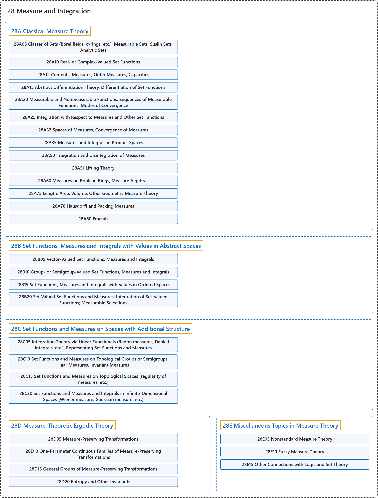

# 28 Measure and Integration

## Classification

## Glossary

| Term | Definition | 中文翻译 | Source |
|---|---|---|---|
| **28 Measure and Integration** 测度与积分 | "Measure theory is the **study of measures**. It generalizes the intuitive notions of **length, area, and volume**." | 测度论是**对测度的研究**。它推广了**长度、面积和体积**这些直观概念。 | [Weisstein, n.d., "Measure theory" entry, para. 1](https://mathworld.wolfram.com/MeasureTheory.html#:~:text=Measure%20theory%20is%20the%20study%20of%20measures) |
| **[28A Classical Measure Theory](28a-classical-measure-theory.md)** 经典测度论 | (No definition) | （无定义） | [Associate Editors of Mathematical Reviews and zbMATH, 2020](https://msc2020.org/) |
| **[28B Set Functions, Measures and Integrals with Values in Abstract Spaces](28b-set-functions-measures-and-integrals-with-values-in-abstract.md)** 取值于抽象空间的集函数、测度与积分 | (No definition) | （无定义） | [Associate Editors of Mathematical Reviews and zbMATH, 2020](https://msc2020.org/) |
| **[28C Set Functions and Measures on Spaces with Additional Structure](28c-set-functions-and-measures-on-spaces-with-additional-structu.md)** 带附加结构空间上的集函数与测度 | (No definition) | （无定义） | [Associate Editors of Mathematical Reviews and zbMATH, 2020](https://msc2020.org/) |
| **[28D Measure-Theoretic Ergodic Theory](28d-measure-theoretic-ergodic-theory.md)** 测度论遍历理论 | (No definition) | （无定义） | [Associate Editors of Mathematical Reviews and zbMATH, 2020](https://msc2020.org/) |
| **[28E Miscellaneous Topics in Measure Theory](28e-miscellaneous-topics-in-measure-theory.md)** 测度论的杂项专题 | (No definition) | （无定义） | [Associate Editors of Mathematical Reviews and zbMATH, 2020](https://msc2020.org/) |

## References

Associate Editors of Mathematical Reviews and zbMATH. (2020). *MSC2020: Mathematics Subject Classification system*. Retrieved October 27, 2026, from <https://msc2020.org/>

Weisstein, E. W. (n.d.). *Measure theory*. MathWorld: A Wolfram Resource. Retrieved October 27, 2026, from <https://mathworld.wolfram.com/MeasureTheory.html>
