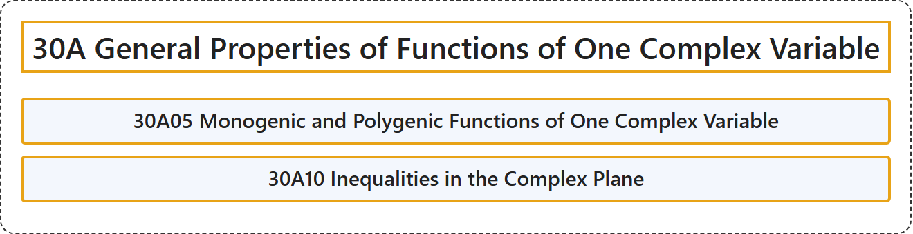

# 30A General Properties of Functions of One Complex Variable

## Classification

## Glossary

| Term | Definition | 中文翻译 | Source |
|---|---|---|---|
| **30A General Properties of Functions of One Complex Variable** 一复变函数的一般性质 | (No definition) | （无定义） | [Associate Editors of Mathematical Reviews and zbMATH, 2020](https://msc2020.org/) |
| **30A05 Monogenic and Polygenic Functions of One Complex Variable** 一复变量的单演函数与多演函数 | (No definition) | （无定义） | [Associate Editors of Mathematical Reviews and zbMATH, 2020](https://msc2020.org/) |
| **30A10 Inequalities in the Complex Plane** 复平面中的不等式 | (No definition) | （无定义） | [Associate Editors of Mathematical Reviews and zbMATH, 2020](https://msc2020.org/) |

## References

Associate Editors of Mathematical Reviews and zbMATH. (2020). *MSC2020: Mathematics Subject Classification system*. Retrieved October 27, 2026, from <https://msc2020.org/>
