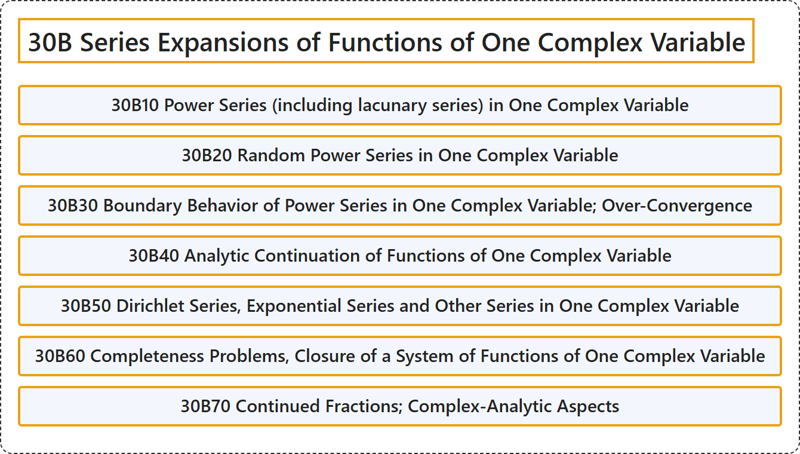

# 30B Series Expansions of Functions of One Complex Variable

## Classification

## Glossary

| Term | Definition | 中文翻译 | Source |
|---|---|---|---|
| **30B Series Expansions of Functions of One Complex Variable** 一复变函数的级数展开 | (No definition) | （无定义） | [Associate Editors of Mathematical Reviews and zbMATH, 2020](https://msc2020.org/) |
| **30B10 Power Series (including lacunary series) in One Complex Variable** 一复变量的幂级数（包括缺项级数） | (No definition) | （无定义） | [Associate Editors of Mathematical Reviews and zbMATH, 2020](https://msc2020.org/) |
| **30B20 Random Power Series in One Complex Variable** 一复变量的随机幂级数 | (No definition) | （无定义） | [Associate Editors of Mathematical Reviews and zbMATH, 2020](https://msc2020.org/) |
| **30B30 Boundary Behavior of Power Series in One Complex Variable; Over-Convergence** 一复变量幂级数的边界性态；超收敛 | (No definition) | （无定义） | [Associate Editors of Mathematical Reviews and zbMATH, 2020](https://msc2020.org/) |
| **30B40 Analytic Continuation of Functions of One Complex Variable** 一复变量函数的解析延拓 | (No definition) | （无定义） | [Associate Editors of Mathematical Reviews and zbMATH, 2020](https://msc2020.org/) |
| **30B50 Dirichlet Series, Exponential Series and Other Series in One Complex Variable** 一复变量的狄利克雷级数、指数级数及其他级数 | (No definition) | （无定义） | [Associate Editors of Mathematical Reviews and zbMATH, 2020](https://msc2020.org/) |
| **30B60 Completeness Problems, Closure of a System of Functions of One Complex Variable** 完备性问题、一复变量函数系的闭包 | (No definition) | （无定义） | [Associate Editors of Mathematical Reviews and zbMATH, 2020](https://msc2020.org/) |
| **30B70 Continued Fractions; Complex-Analytic Aspects** 连分数；复解析方面 | (No definition) | （无定义） | [Associate Editors of Mathematical Reviews and zbMATH, 2020](https://msc2020.org/) |

## References

Associate Editors of Mathematical Reviews and zbMATH. (2020). *MSC2020: Mathematics Subject Classification system*. Retrieved October 27, 2026, from <https://msc2020.org/>
