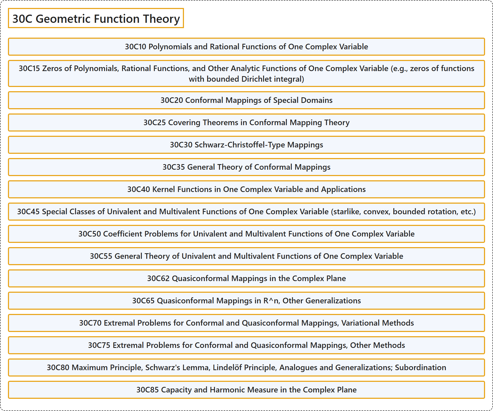

# 30C Geometric Function Theory

## Classification

## Glossary

| Term | Definition | 中文翻译 | Source |
|---|---|---|---|
| **30C Geometric Function Theory** 几何函数论 | (No definition) | （无定义） | [Associate Editors of Mathematical Reviews and zbMATH, 2020](https://msc2020.org/) |
| **30C10 Polynomials and Rational Functions of One Complex Variable** 一复变量的多项式与有理函数 | (No definition) | （无定义） | [Associate Editors of Mathematical Reviews and zbMATH, 2020](https://msc2020.org/) |
| **30C15 Zeros of Polynomials, Rational Functions, and Other Analytic Functions of One Complex Variable (e.g., zeros of functions with bounded Dirichlet integral)** 一复变量的多项式、有理函数及其他解析函数的零点（例如具有有界狄利克雷积分的函数的零点） | (No definition) | （无定义） | [Associate Editors of Mathematical Reviews and zbMATH, 2020](https://msc2020.org/) |
| **30C20 Conformal Mappings of Special Domains** 特殊区域的共形映射 | (No definition) | （无定义） | [Associate Editors of Mathematical Reviews and zbMATH, 2020](https://msc2020.org/) |
| **30C25 Covering Theorems in Conformal Mapping Theory** 共形映射理论中的覆盖定理 | (No definition) | （无定义） | [Associate Editors of Mathematical Reviews and zbMATH, 2020](https://msc2020.org/) |
| **30C30 Schwarz-Christoffel-Type Mappings** 施瓦茨-克里斯托费尔型映射 | (No definition) | （无定义） | [Associate Editors of Mathematical Reviews and zbMATH, 2020](https://msc2020.org/) |
| **30C35 General Theory of Conformal Mappings** 共形映射的一般理论 | (No definition) | （无定义） | [Associate Editors of Mathematical Reviews and zbMATH, 2020](https://msc2020.org/) |
| **30C40 Kernel Functions in One Complex Variable and Applications** 一复变量的核函数及其应用 | (No definition) | （无定义） | [Associate Editors of Mathematical Reviews and zbMATH, 2020](https://msc2020.org/) |
| **30C45 Special Classes of Univalent and Multivalent Functions of One Complex Variable (starlike, convex, bounded rotation, etc.)** 一复变量单叶函数与多叶函数的特殊类（星形、凸、有界旋转等） | (No definition) | （无定义） | [Associate Editors of Mathematical Reviews and zbMATH, 2020](https://msc2020.org/) |
| **30C50 Coefficient Problems for Univalent and Multivalent Functions of One Complex Variable** 一复变量单叶函数与多叶函数的系数问题 | (No definition) | （无定义） | [Associate Editors of Mathematical Reviews and zbMATH, 2020](https://msc2020.org/) |
| **30C55 General Theory of Univalent and Multivalent Functions of One Complex Variable** 一复变量单叶函数与多叶函数的一般理论 | (No definition) | （无定义） | [Associate Editors of Mathematical Reviews and zbMATH, 2020](https://msc2020.org/) |
| **30C62 Quasiconformal Mappings in the Complex Plane** 复平面中的拟共形映射 | (No definition) | （无定义） | [Associate Editors of Mathematical Reviews and zbMATH, 2020](https://msc2020.org/) |
| **30C65 Quasiconformal Mappings in R^n, Other Generalizations** R^n中的拟共形映射、其他推广 | (No definition) | （无定义） | [Associate Editors of Mathematical Reviews and zbMATH, 2020](https://msc2020.org/) |
| **30C70 Extremal Problems for Conformal and Quasiconformal Mappings, Variational Methods** 共形映射与拟共形映射的极值问题、变分方法 | (No definition) | （无定义） | [Associate Editors of Mathematical Reviews and zbMATH, 2020](https://msc2020.org/) |
| **30C75 Extremal Problems for Conformal and Quasiconformal Mappings, Other Methods** 共形映射与拟共形映射的极值问题、其他方法 | (No definition) | （无定义） | [Associate Editors of Mathematical Reviews and zbMATH, 2020](https://msc2020.org/) |
| **30C80 Maximum Principle, Schwarz's Lemma, Lindelöf Principle, Analogues and Generalizations; Subordination** 最大值原理、施瓦茨引理、林德勒夫原理、类似结果与推广；从属 | (No definition) | （无定义） | [Associate Editors of Mathematical Reviews and zbMATH, 2020](https://msc2020.org/) |
| **30C85 Capacity and Harmonic Measure in the Complex Plane** 复平面中的容量与调和测度 | (No definition) | （无定义） | [Associate Editors of Mathematical Reviews and zbMATH, 2020](https://msc2020.org/) |

## References

Associate Editors of Mathematical Reviews and zbMATH. (2020). *MSC2020: Mathematics Subject Classification system*. Retrieved October 27, 2026, from <https://msc2020.org/>
