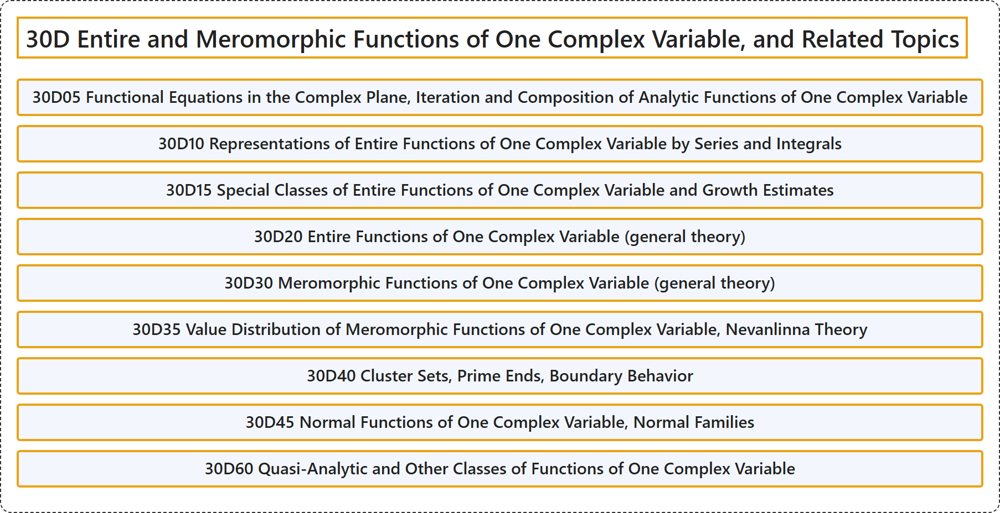

# 30D Entire and Meromorphic Functions of One Complex Variable, and Related Topics

## Classification

## Glossary

| Term | Definition | 中文翻译 | Source |
|---|---|---|---|
| **30D Entire and Meromorphic Functions of One Complex Variable, and Related Topics** 一复变整函数与亚纯函数及相关专题 | (No definition) | （无定义） | [Associate Editors of Mathematical Reviews and zbMATH, 2020](https://msc2020.org/) |
| **30D05 Functional Equations in the Complex Plane, Iteration and Composition of Analytic Functions of One Complex Variable** 复平面中的函数方程、一复变量解析函数的迭代与复合 | (No definition) | （无定义） | [Associate Editors of Mathematical Reviews and zbMATH, 2020](https://msc2020.org/) |
| **30D10 Representations of Entire Functions of One Complex Variable by Series and Integrals** 一复变量整函数的级数表示与积分表示 | (No definition) | （无定义） | [Associate Editors of Mathematical Reviews and zbMATH, 2020](https://msc2020.org/) |
| **30D15 Special Classes of Entire Functions of One Complex Variable and Growth Estimates** 一复变量整函数的特殊类与增长估计 | (No definition) | （无定义） | [Associate Editors of Mathematical Reviews and zbMATH, 2020](https://msc2020.org/) |
| **30D20 Entire Functions of One Complex Variable (general theory)** 一复变量整函数（一般理论） | (No definition) | （无定义） | [Associate Editors of Mathematical Reviews and zbMATH, 2020](https://msc2020.org/) |
| **30D30 Meromorphic Functions of One Complex Variable (general theory)** 一复变量亚纯函数（一般理论） | (No definition) | （无定义） | [Associate Editors of Mathematical Reviews and zbMATH, 2020](https://msc2020.org/) |
| **30D35 Value Distribution of Meromorphic Functions of One Complex Variable, Nevanlinna Theory** 一复变量亚纯函数的值分布、奈望林纳理论 | (No definition) | （无定义） | [Associate Editors of Mathematical Reviews and zbMATH, 2020](https://msc2020.org/) |
| **30D40 Cluster Sets, Prime Ends, Boundary Behavior** 聚集集、素端、边界性态 | (No definition) | （无定义） | [Associate Editors of Mathematical Reviews and zbMATH, 2020](https://msc2020.org/) |
| **30D45 Normal Functions of One Complex Variable, Normal Families** 一复变量正规函数、正规族 | (No definition) | （无定义） | [Associate Editors of Mathematical Reviews and zbMATH, 2020](https://msc2020.org/) |
| **30D60 Quasi-Analytic and Other Classes of Functions of One Complex Variable** 一复变量的拟解析函数及其他函数类 | (No definition) | （无定义） | [Associate Editors of Mathematical Reviews and zbMATH, 2020](https://msc2020.org/) |

## References

Associate Editors of Mathematical Reviews and zbMATH. (2020). *MSC2020: Mathematics Subject Classification system*. Retrieved October 27, 2026, from <https://msc2020.org/>
