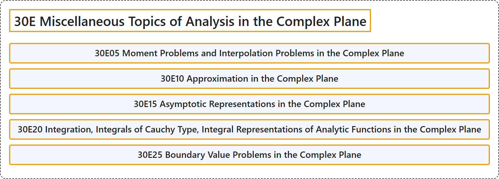

# 30E Miscellaneous Topics of Analysis in the Complex Plane

## Classification

## Glossary

| Term | Definition | 中文翻译 | Source |
|---|---|---|---|
| **30E Miscellaneous Topics of Analysis in the Complex Plane** 复平面上分析的杂项专题 | (No definition) | （无定义） | [Associate Editors of Mathematical Reviews and zbMATH, 2020](https://msc2020.org/) |
| **30E05 Moment Problems and Interpolation Problems in the Complex Plane** 复平面中的矩问题与插值问题 | (No definition) | （无定义） | [Associate Editors of Mathematical Reviews and zbMATH, 2020](https://msc2020.org/) |
| **30E10 Approximation in the Complex Plane** 复平面中的逼近 | (No definition) | （无定义） | [Associate Editors of Mathematical Reviews and zbMATH, 2020](https://msc2020.org/) |
| **30E15 Asymptotic Representations in the Complex Plane** 复平面中的渐近表示 | (No definition) | （无定义） | [Associate Editors of Mathematical Reviews and zbMATH, 2020](https://msc2020.org/) |
| **30E20 Integration, Integrals of Cauchy Type, Integral Representations of Analytic Functions in the Complex Plane** 积分、柯西型积分、复平面中解析函数的积分表示 | (No definition) | （无定义） | [Associate Editors of Mathematical Reviews and zbMATH, 2020](https://msc2020.org/) |
| **30E25 Boundary Value Problems in the Complex Plane** 复平面中的边值问题 | (No definition) | （无定义） | [Associate Editors of Mathematical Reviews and zbMATH, 2020](https://msc2020.org/) |

## References

Associate Editors of Mathematical Reviews and zbMATH. (2020). *MSC2020: Mathematics Subject Classification system*. Retrieved October 27, 2026, from <https://msc2020.org/>
