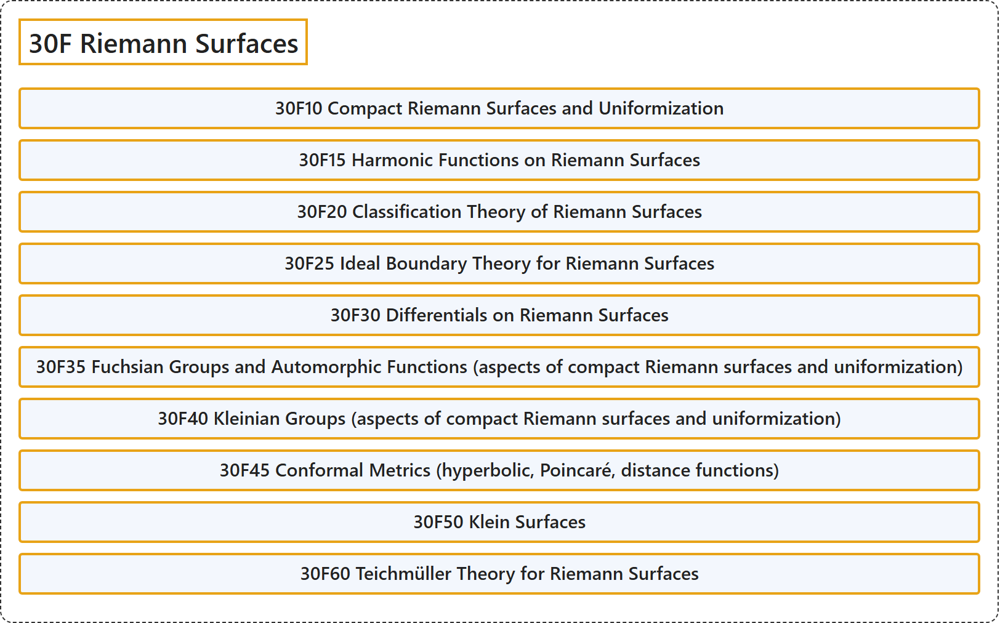

# 30F Riemann Surfaces

## Classification

## Glossary

| Term | Definition | 中文翻译 | Source |
|---|---|---|---|
| **30F Riemann Surfaces** 黎曼曲面 | (No definition) | （无定义） | [Associate Editors of Mathematical Reviews and zbMATH, 2020](https://msc2020.org/) |
| **30F10 Compact Riemann Surfaces and Uniformization** 紧黎曼曲面与单值化 | (No definition) | （无定义） | [Associate Editors of Mathematical Reviews and zbMATH, 2020](https://msc2020.org/) |
| **30F15 Harmonic Functions on Riemann Surfaces** 黎曼曲面上的调和函数 | (No definition) | （无定义） | [Associate Editors of Mathematical Reviews and zbMATH, 2020](https://msc2020.org/) |
| **30F20 Classification Theory of Riemann Surfaces** 黎曼曲面的分类理论 | (No definition) | （无定义） | [Associate Editors of Mathematical Reviews and zbMATH, 2020](https://msc2020.org/) |
| **30F25 Ideal Boundary Theory for Riemann Surfaces** 黎曼曲面的理想边界理论 | (No definition) | （无定义） | [Associate Editors of Mathematical Reviews and zbMATH, 2020](https://msc2020.org/) |
| **30F30 Differentials on Riemann Surfaces** 黎曼曲面上的微分 | (No definition) | （无定义） | [Associate Editors of Mathematical Reviews and zbMATH, 2020](https://msc2020.org/) |
| **30F35 Fuchsian Groups and Automorphic Functions (aspects of compact Riemann surfaces and uniformization)** 富克斯群与自守函数（紧黎曼曲面与单值化的方面） | (No definition) | （无定义） | [Associate Editors of Mathematical Reviews and zbMATH, 2020](https://msc2020.org/) |
| **30F40 Kleinian Groups (aspects of compact Riemann surfaces and uniformization)** 克莱因群（紧黎曼曲面与单值化的方面） | (No definition) | （无定义） | [Associate Editors of Mathematical Reviews and zbMATH, 2020](https://msc2020.org/) |
| **30F45 Conformal Metrics (hyperbolic, Poincaré, distance functions)** 共形度量（双曲、庞加莱、距离函数） | (No definition) | （无定义） | [Associate Editors of Mathematical Reviews and zbMATH, 2020](https://msc2020.org/) |
| **30F50 Klein Surfaces** 克莱因曲面 | (No definition) | （无定义） | [Associate Editors of Mathematical Reviews and zbMATH, 2020](https://msc2020.org/) |
| **30F60 Teichmüller Theory for Riemann Surfaces** 黎曼曲面的泰希米勒理论 | (No definition) | （无定义） | [Associate Editors of Mathematical Reviews and zbMATH, 2020](https://msc2020.org/) |

## References

Associate Editors of Mathematical Reviews and zbMATH. (2020). *MSC2020: Mathematics Subject Classification system*. Retrieved October 27, 2026, from <https://msc2020.org/>
