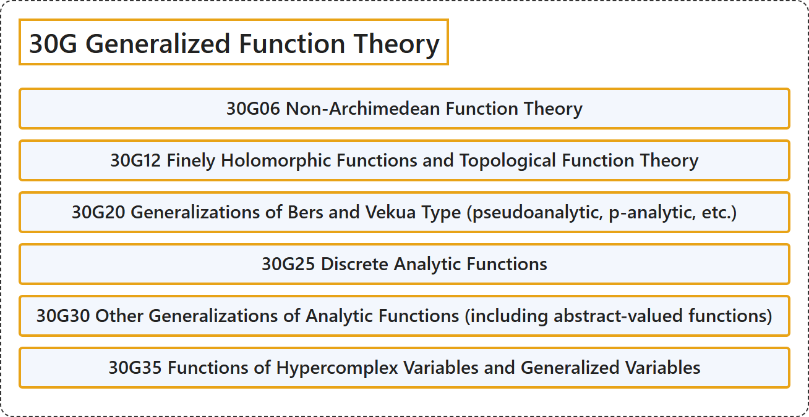

# 30G Generalized Function Theory

## Classification

## Glossary

| Term | Definition | 中文翻译 | Source |
|---|---|---|---|
| **30G Generalized Function Theory** 广义函数论 | (No definition) | （无定义） | [Associate Editors of Mathematical Reviews and zbMATH, 2020](https://msc2020.org/) |
| **30G06 Non-Archimedean Function Theory** 非阿基米德函数论 | (No definition) | （无定义） | [Associate Editors of Mathematical Reviews and zbMATH, 2020](https://msc2020.org/) |
| **30G12 Finely Holomorphic Functions and Topological Function Theory** 精细全纯函数与拓扑函数论 | (No definition) | （无定义） | [Associate Editors of Mathematical Reviews and zbMATH, 2020](https://msc2020.org/) |
| **30G20 Generalizations of Bers and Vekua Type (pseudoanalytic, p-analytic, etc.)** 伯斯型与韦库阿型推广（伪解析、p解析等） | (No definition) | （无定义） | [Associate Editors of Mathematical Reviews and zbMATH, 2020](https://msc2020.org/) |
| **30G25 Discrete Analytic Functions** 离散解析函数 | (No definition) | （无定义） | [Associate Editors of Mathematical Reviews and zbMATH, 2020](https://msc2020.org/) |
| **30G30 Other Generalizations of Analytic Functions (including abstract-valued functions)** 解析函数的其他推广（包括抽象值函数） | (No definition) | （无定义） | [Associate Editors of Mathematical Reviews and zbMATH, 2020](https://msc2020.org/) |
| **30G35 Functions of Hypercomplex Variables and Generalized Variables** 超复变量与广义变量的函数 | (No definition) | （无定义） | [Associate Editors of Mathematical Reviews and zbMATH, 2020](https://msc2020.org/) |

## References

Associate Editors of Mathematical Reviews and zbMATH. (2020). *MSC2020: Mathematics Subject Classification system*. Retrieved October 27, 2026, from <https://msc2020.org/>
