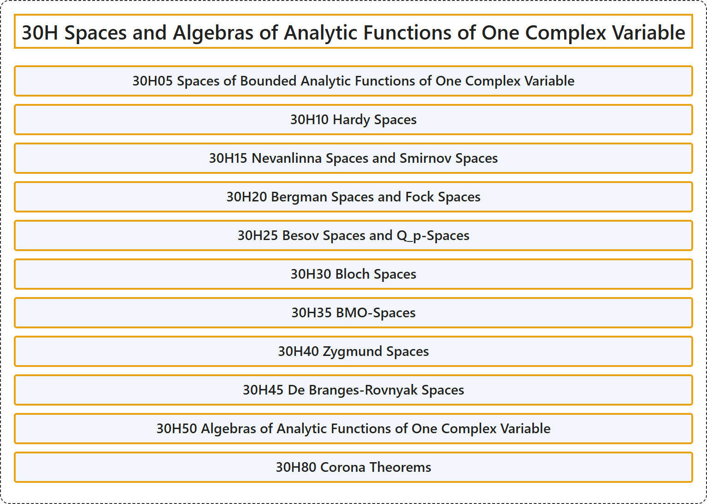

# 30H Spaces and Algebras of Analytic Functions of One Complex Variable

## Classification

## Glossary

| Term | Definition | 中文翻译 | Source |
|---|---|---|---|
| **30H Spaces and Algebras of Analytic Functions of One Complex Variable** 一复变解析函数的空间与代数 | (No definition) | （无定义） | [Associate Editors of Mathematical Reviews and zbMATH, 2020](https://msc2020.org/) |
| **30H05 Spaces of Bounded Analytic Functions of One Complex Variable** 一复变量有界解析函数空间 | (No definition) | （无定义） | [Associate Editors of Mathematical Reviews and zbMATH, 2020](https://msc2020.org/) |
| **30H10 Hardy Spaces** 哈代空间 | (No definition) | （无定义） | [Associate Editors of Mathematical Reviews and zbMATH, 2020](https://msc2020.org/) |
| **30H15 Nevanlinna Spaces and Smirnov Spaces** 奈望林纳空间与斯米尔诺夫空间 | (No definition) | （无定义） | [Associate Editors of Mathematical Reviews and zbMATH, 2020](https://msc2020.org/) |
| **30H20 Bergman Spaces and Fock Spaces** 伯格曼空间与福克空间 | (No definition) | （无定义） | [Associate Editors of Mathematical Reviews and zbMATH, 2020](https://msc2020.org/) |
| **30H25 Besov Spaces and Q_p-Spaces** 贝索夫空间与Q_p空间 | (No definition) | （无定义） | [Associate Editors of Mathematical Reviews and zbMATH, 2020](https://msc2020.org/) |
| **30H30 Bloch Spaces** 布洛赫空间 | (No definition) | （无定义） | [Associate Editors of Mathematical Reviews and zbMATH, 2020](https://msc2020.org/) |
| **30H35 BMO-Spaces** BMO空间 | (No definition) | （无定义） | [Associate Editors of Mathematical Reviews and zbMATH, 2020](https://msc2020.org/) |
| **30H40 Zygmund Spaces** 齐格蒙德空间 | (No definition) | （无定义） | [Associate Editors of Mathematical Reviews and zbMATH, 2020](https://msc2020.org/) |
| **30H45 De Branges-Rovnyak Spaces** 德布朗吉斯-罗夫尼亚克空间 | (No definition) | （无定义） | [Associate Editors of Mathematical Reviews and zbMATH, 2020](https://msc2020.org/) |
| **30H50 Algebras of Analytic Functions of One Complex Variable** 一复变量解析函数代数 | (No definition) | （无定义） | [Associate Editors of Mathematical Reviews and zbMATH, 2020](https://msc2020.org/) |
| **30H80 Corona Theorems** 冕定理 | (No definition) | （无定义） | [Associate Editors of Mathematical Reviews and zbMATH, 2020](https://msc2020.org/) |

## References

Associate Editors of Mathematical Reviews and zbMATH. (2020). *MSC2020: Mathematics Subject Classification system*. Retrieved October 27, 2026, from <https://msc2020.org/>
