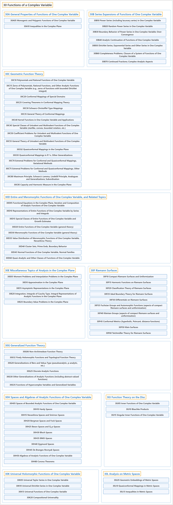

# 30 Functions of a Complex Variable

## Classification

## Glossary

| Term | Definition | 中文翻译 | Source |
|---|---|---|---|
| **30 Functions of a Complex Variable** 复变函数 | (context) "Complex analysis is the study of **complex numbers together with their derivatives**, manipulation, and other properties." | （语境）复分析研究**复数及其导数**、运算和其他性质。 | [Weisstein, n.d., "Complex analysis" entry, para. 1](https://mathworld.wolfram.com/ComplexAnalysis.html#:~:text=Complex%20analysis%20is%20the%20study%20of%20complex%20numbers) |
| **[30A General Properties of Functions of One Complex Variable](30a-general-properties-of-functions-of-one-complex-variable.md)** 一复变函数的一般性质 | (No definition) | （无定义） | [Associate Editors of Mathematical Reviews and zbMATH, 2020](https://msc2020.org/) |
| **[30B Series Expansions of Functions of One Complex Variable](30b-series-expansions-of-functions-of-one-complex-variable.md)** 一复变函数的级数展开 | (No definition) | （无定义） | [Associate Editors of Mathematical Reviews and zbMATH, 2020](https://msc2020.org/) |
| **[30C Geometric Function Theory](30c-geometric-function-theory.md)** 几何函数论 | (No definition) | （无定义） | [Associate Editors of Mathematical Reviews and zbMATH, 2020](https://msc2020.org/) |
| **[30D Entire and Meromorphic Functions of One Complex Variable, and Related Topics](30d-entire-and-meromorphic-functions-of-one-complex-variable-and.md)** 一复变整函数与亚纯函数及相关专题 | (No definition) | （无定义） | [Associate Editors of Mathematical Reviews and zbMATH, 2020](https://msc2020.org/) |
| **[30E Miscellaneous Topics of Analysis in the Complex Plane](30e-miscellaneous-topics-of-analysis-in-the-complex-plane.md)** 复平面上分析的杂项专题 | (No definition) | （无定义） | [Associate Editors of Mathematical Reviews and zbMATH, 2020](https://msc2020.org/) |
| **[30F Riemann Surfaces](30f-riemann-surfaces.md)** 黎曼曲面 | (No definition) | （无定义） | [Associate Editors of Mathematical Reviews and zbMATH, 2020](https://msc2020.org/) |
| **[30G Generalized Function Theory](30g-generalized-function-theory.md)** 广义函数论 | (No definition) | （无定义） | [Associate Editors of Mathematical Reviews and zbMATH, 2020](https://msc2020.org/) |
| **[30H Spaces and Algebras of Analytic Functions of One Complex Variable](30h-spaces-and-algebras-of-analytic-functions-of-one-complex-var.md)** 一复变解析函数的空间与代数 | (No definition) | （无定义） | [Associate Editors of Mathematical Reviews and zbMATH, 2020](https://msc2020.org/) |
| **[30J Function Theory on the Disc](30j-function-theory-on-the-disc.md)** 圆盘上的函数论 | (No definition) | （无定义） | [Associate Editors of Mathematical Reviews and zbMATH, 2020](https://msc2020.org/) |
| **[30K Universal Holomorphic Functions of One Complex Variable](30k-universal-holomorphic-functions-of-one-complex-variable.md)** 一复变万有全纯函数 | (No definition) | （无定义） | [Associate Editors of Mathematical Reviews and zbMATH, 2020](https://msc2020.org/) |
| **[30L Analysis on Metric Spaces](30l-analysis-on-metric-spaces.md)** 度量空间上的分析 | (No definition) | （无定义） | [Associate Editors of Mathematical Reviews and zbMATH, 2020](https://msc2020.org/) |

## References

Associate Editors of Mathematical Reviews and zbMATH. (2020). *MSC2020: Mathematics Subject Classification system*. Retrieved October 27, 2026, from <https://msc2020.org/>

Weisstein, E. W. (n.d.). *Complex analysis*. MathWorld: A Wolfram Resource. Retrieved October 27, 2026, from <https://mathworld.wolfram.com/ComplexAnalysis.html>
