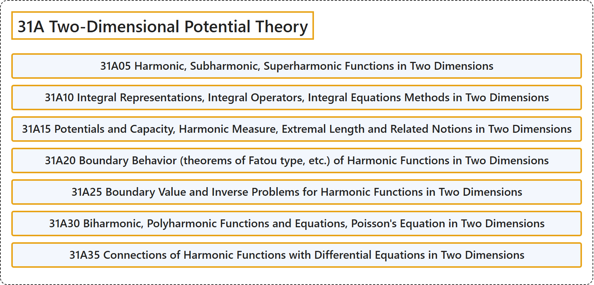

# 31A Two-Dimensional Potential Theory

## Classification

## Glossary

| Term | Definition | 中文翻译 | Source |
|---|---|---|---|
| **31A Two-Dimensional Potential Theory** 二维位势论 | (No definition) | （无定义） | [Associate Editors of Mathematical Reviews and zbMATH, 2020](https://msc2020.org/) |
| **31A05 Harmonic, Subharmonic, Superharmonic Functions in Two Dimensions** 二维调和函数、次调和函数、上调和函数 | (No definition) | （无定义） | [Associate Editors of Mathematical Reviews and zbMATH, 2020](https://msc2020.org/) |
| **31A10 Integral Representations, Integral Operators, Integral Equations Methods in Two Dimensions** 二维的积分表示、积分算子、积分方程方法 | (No definition) | （无定义） | [Associate Editors of Mathematical Reviews and zbMATH, 2020](https://msc2020.org/) |
| **31A15 Potentials and Capacity, Harmonic Measure, Extremal Length and Related Notions in Two Dimensions** 二维的位势与容量、调和测度、极值长度及相关概念 | (No definition) | （无定义） | [Associate Editors of Mathematical Reviews and zbMATH, 2020](https://msc2020.org/) |
| **31A20 Boundary Behavior (theorems of Fatou type, etc.) of Harmonic Functions in Two Dimensions** 二维调和函数的边界性态（法图型定理等） | (No definition) | （无定义） | [Associate Editors of Mathematical Reviews and zbMATH, 2020](https://msc2020.org/) |
| **31A25 Boundary Value and Inverse Problems for Harmonic Functions in Two Dimensions** 二维调和函数的边值问题与反问题 | (No definition) | （无定义） | [Associate Editors of Mathematical Reviews and zbMATH, 2020](https://msc2020.org/) |
| **31A30 Biharmonic, Polyharmonic Functions and Equations, Poisson's Equation in Two Dimensions** 二维的双调和函数、多重调和函数与方程、泊松方程 | (No definition) | （无定义） | [Associate Editors of Mathematical Reviews and zbMATH, 2020](https://msc2020.org/) |
| **31A35 Connections of Harmonic Functions with Differential Equations in Two Dimensions** 二维调和函数与微分方程的联系 | (No definition) | （无定义） | [Associate Editors of Mathematical Reviews and zbMATH, 2020](https://msc2020.org/) |

## References

Associate Editors of Mathematical Reviews and zbMATH. (2020). *MSC2020: Mathematics Subject Classification system*. Retrieved October 27, 2026, from <https://msc2020.org/>
