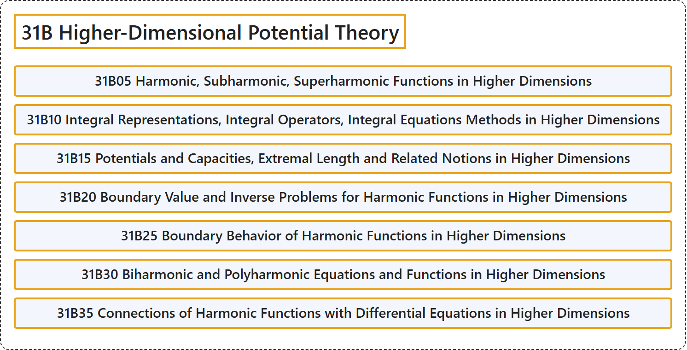

# 31B Higher-Dimensional Potential Theory

## Classification

## Glossary

| Term | Definition | 中文翻译 | Source |
|---|---|---|---|
| **31B Higher-Dimensional Potential Theory** 高维位势论 | (No definition) | （无定义） | [Associate Editors of Mathematical Reviews and zbMATH, 2020](https://msc2020.org/) |
| **31B05 Harmonic, Subharmonic, Superharmonic Functions in Higher Dimensions** 高维调和函数、次调和函数、上调和函数 | (No definition) | （无定义） | [Associate Editors of Mathematical Reviews and zbMATH, 2020](https://msc2020.org/) |
| **31B10 Integral Representations, Integral Operators, Integral Equations Methods in Higher Dimensions** 高维的积分表示、积分算子、积分方程方法 | (No definition) | （无定义） | [Associate Editors of Mathematical Reviews and zbMATH, 2020](https://msc2020.org/) |
| **31B15 Potentials and Capacities, Extremal Length and Related Notions in Higher Dimensions** 高维的位势与容量、极值长度及相关概念 | (No definition) | （无定义） | [Associate Editors of Mathematical Reviews and zbMATH, 2020](https://msc2020.org/) |
| **31B20 Boundary Value and Inverse Problems for Harmonic Functions in Higher Dimensions** 高维调和函数的边值问题与反问题 | (No definition) | （无定义） | [Associate Editors of Mathematical Reviews and zbMATH, 2020](https://msc2020.org/) |
| **31B25 Boundary Behavior of Harmonic Functions in Higher Dimensions** 高维调和函数的边界性态 | (No definition) | （无定义） | [Associate Editors of Mathematical Reviews and zbMATH, 2020](https://msc2020.org/) |
| **31B30 Biharmonic and Polyharmonic Equations and Functions in Higher Dimensions** 高维的双调和与多重调和方程及函数 | (No definition) | （无定义） | [Associate Editors of Mathematical Reviews and zbMATH, 2020](https://msc2020.org/) |
| **31B35 Connections of Harmonic Functions with Differential Equations in Higher Dimensions** 高维调和函数与微分方程的联系 | (No definition) | （无定义） | [Associate Editors of Mathematical Reviews and zbMATH, 2020](https://msc2020.org/) |

## References

Associate Editors of Mathematical Reviews and zbMATH. (2020). *MSC2020: Mathematics Subject Classification system*. Retrieved October 27, 2026, from <https://msc2020.org/>
