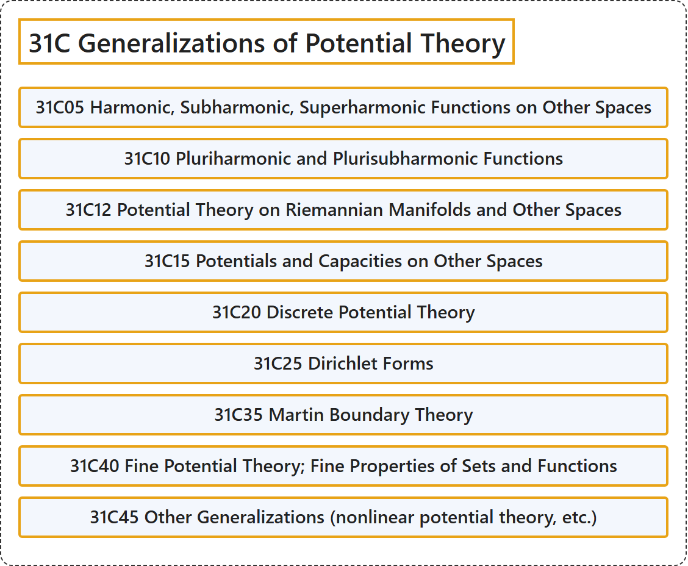

# 31C Generalizations of Potential Theory

## Classification

## Glossary

| Term | Definition | 中文翻译 | Source |
|---|---|---|---|
| **31C Generalizations of Potential Theory** 位势论的推广 | (No definition) | （无定义） | [Associate Editors of Mathematical Reviews and zbMATH, 2020](https://msc2020.org/) |
| **31C05 Harmonic, Subharmonic, Superharmonic Functions on Other Spaces** 其他空间上的调和函数、次调和函数、上调和函数 | (No definition) | （无定义） | [Associate Editors of Mathematical Reviews and zbMATH, 2020](https://msc2020.org/) |
| **31C10 Pluriharmonic and Plurisubharmonic Functions** 多重调和函数与多重次调和函数 | (No definition) | （无定义） | [Associate Editors of Mathematical Reviews and zbMATH, 2020](https://msc2020.org/) |
| **31C12 Potential Theory on Riemannian Manifolds and Other Spaces** 黎曼流形及其他空间上的位势论 | (No definition) | （无定义） | [Associate Editors of Mathematical Reviews and zbMATH, 2020](https://msc2020.org/) |
| **31C15 Potentials and Capacities on Other Spaces** 其他空间上的位势与容量 | (No definition) | （无定义） | [Associate Editors of Mathematical Reviews and zbMATH, 2020](https://msc2020.org/) |
| **31C20 Discrete Potential Theory** 离散位势论 | (No definition) | （无定义） | [Associate Editors of Mathematical Reviews and zbMATH, 2020](https://msc2020.org/) |
| **31C25 Dirichlet Forms** 狄利克雷型 | (No definition) | （无定义） | [Associate Editors of Mathematical Reviews and zbMATH, 2020](https://msc2020.org/) |
| **31C35 Martin Boundary Theory** 马丁边界理论 | (No definition) | （无定义） | [Associate Editors of Mathematical Reviews and zbMATH, 2020](https://msc2020.org/) |
| **31C40 Fine Potential Theory; Fine Properties of Sets and Functions** 精细位势论；集合与函数的精细性质 | (No definition) | （无定义） | [Associate Editors of Mathematical Reviews and zbMATH, 2020](https://msc2020.org/) |
| **31C45 Other Generalizations (nonlinear potential theory, etc.)** 其他推广（非线性位势论等） | (No definition) | （无定义） | [Associate Editors of Mathematical Reviews and zbMATH, 2020](https://msc2020.org/) |

## References

Associate Editors of Mathematical Reviews and zbMATH. (2020). *MSC2020: Mathematics Subject Classification system*. Retrieved October 27, 2026, from <https://msc2020.org/>
