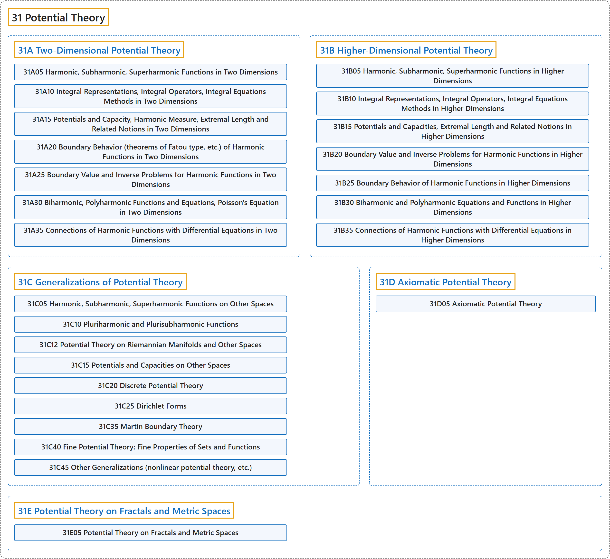

# 31 Potential Theory

## Classification

## Glossary

| Term | Definition | 中文翻译 | Source |
|---|---|---|---|
| **31 Potential Theory** 位势论 | "The study of **harmonic functions** (also called potential functions)." | 对**调和函数**（也称位势函数）的研究。 | [Weisstein, n.d., "Potential theory" entry, para. 1](https://mathworld.wolfram.com/PotentialTheory.html#:~:text=The%20study%20of%20harmonic%20functions) |
| **[31A Two-Dimensional Potential Theory](31a-two-dimensional-potential-theory.md)** 二维位势论 | (No definition) | （无定义） | [Associate Editors of Mathematical Reviews and zbMATH, 2020](https://msc2020.org/) |
| **[31B Higher-Dimensional Potential Theory](31b-higher-dimensional-potential-theory.md)** 高维位势论 | (No definition) | （无定义） | [Associate Editors of Mathematical Reviews and zbMATH, 2020](https://msc2020.org/) |
| **[31C Generalizations of Potential Theory](31c-generalizations-of-potential-theory.md)** 位势论的推广 | (No definition) | （无定义） | [Associate Editors of Mathematical Reviews and zbMATH, 2020](https://msc2020.org/) |
| **[31D Axiomatic Potential Theory](31d-axiomatic-potential-theory.md)** 公理化位势论 | (No definition) | （无定义） | [Associate Editors of Mathematical Reviews and zbMATH, 2020](https://msc2020.org/) |
| **[31E Potential Theory on Fractals and Metric Spaces](31e-potential-theory-on-fractals-and-metric-spaces.md)** 分形与度量空间上的位势论 | (No definition) | （无定义） | [Associate Editors of Mathematical Reviews and zbMATH, 2020](https://msc2020.org/) |

## References

Associate Editors of Mathematical Reviews and zbMATH. (2020). *MSC2020: Mathematics Subject Classification system*. Retrieved October 27, 2026, from <https://msc2020.org/>

Weisstein, E. W. (n.d.). *Potential theory*. MathWorld: A Wolfram Resource. Retrieved October 27, 2026, from <https://mathworld.wolfram.com/PotentialTheory.html>
