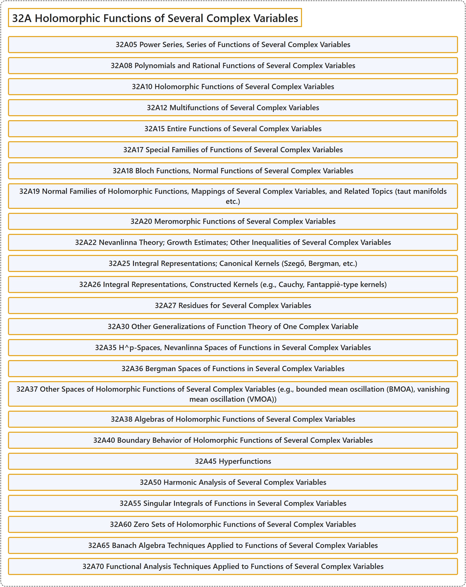

# 32A Holomorphic Functions of Several Complex Variables

## Classification

## Glossary

| Term | Definition | 中文翻译 | Source |
|---|---|---|---|
| **32A Holomorphic Functions of Several Complex Variables** 多复变全纯函数 | (No definition) | （无定义） | [Associate Editors of Mathematical Reviews and zbMATH, 2020](https://msc2020.org/) |
| **32A05 Power Series, Series of Functions of Several Complex Variables** 多复变量的幂级数、函数项级数 | (No definition) | （无定义） | [Associate Editors of Mathematical Reviews and zbMATH, 2020](https://msc2020.org/) |
| **32A08 Polynomials and Rational Functions of Several Complex Variables** 多复变量的多项式与有理函数 | (No definition) | （无定义） | [Associate Editors of Mathematical Reviews and zbMATH, 2020](https://msc2020.org/) |
| **32A10 Holomorphic Functions of Several Complex Variables** 多复变量的全纯函数 | (No definition) | （无定义） | [Associate Editors of Mathematical Reviews and zbMATH, 2020](https://msc2020.org/) |
| **32A12 Multifunctions of Several Complex Variables** 多复变量的多值函数 | (No definition) | （无定义） | [Associate Editors of Mathematical Reviews and zbMATH, 2020](https://msc2020.org/) |
| **32A15 Entire Functions of Several Complex Variables** 多复变量的整函数 | (No definition) | （无定义） | [Associate Editors of Mathematical Reviews and zbMATH, 2020](https://msc2020.org/) |
| **32A17 Special Families of Functions of Several Complex Variables** 多复变量函数的特殊族 | (No definition) | （无定义） | [Associate Editors of Mathematical Reviews and zbMATH, 2020](https://msc2020.org/) |
| **32A18 Bloch Functions, Normal Functions of Several Complex Variables** 多复变量的布洛赫函数、正规函数 | (No definition) | （无定义） | [Associate Editors of Mathematical Reviews and zbMATH, 2020](https://msc2020.org/) |
| **32A19 Normal Families of Holomorphic Functions, Mappings of Several Complex Variables, and Related Topics (taut manifolds etc.)** 全纯函数、多复变量映射的正规族及相关课题（紧致流形等） | (No definition) | （无定义） | [Associate Editors of Mathematical Reviews and zbMATH, 2020](https://msc2020.org/) |
| **32A20 Meromorphic Functions of Several Complex Variables** 多复变量的亚纯函数 | (No definition) | （无定义） | [Associate Editors of Mathematical Reviews and zbMATH, 2020](https://msc2020.org/) |
| **32A22 Nevanlinna Theory; Growth Estimates; Other Inequalities of Several Complex Variables** 奈望林纳理论；增长估计；多复变量的其他不等式 | (No definition) | （无定义） | [Associate Editors of Mathematical Reviews and zbMATH, 2020](https://msc2020.org/) |
| **32A25 Integral Representations; Canonical Kernels (Szegő, Bergman, etc.)** 积分表示；典范核（赛格、伯格曼等） | (No definition) | （无定义） | [Associate Editors of Mathematical Reviews and zbMATH, 2020](https://msc2020.org/) |
| **32A26 Integral Representations, Constructed Kernels (e.g., Cauchy, Fantappiè-type kernels)** 积分表示、构造核（例如柯西核、方塔佩埃型核） | (No definition) | （无定义） | [Associate Editors of Mathematical Reviews and zbMATH, 2020](https://msc2020.org/) |
| **32A27 Residues for Several Complex Variables** 多复变量的留数 | (No definition) | （无定义） | [Associate Editors of Mathematical Reviews and zbMATH, 2020](https://msc2020.org/) |
| **32A30 Other Generalizations of Function Theory of One Complex Variable** 一复变量函数论的其他推广 | (No definition) | （无定义） | [Associate Editors of Mathematical Reviews and zbMATH, 2020](https://msc2020.org/) |
| **32A35 H^p-Spaces, Nevanlinna Spaces of Functions in Several Complex Variables** 多复变量函数的H^p空间、奈望林纳空间 | (No definition) | （无定义） | [Associate Editors of Mathematical Reviews and zbMATH, 2020](https://msc2020.org/) |
| **32A36 Bergman Spaces of Functions in Several Complex Variables** 多复变量函数的伯格曼空间 | (No definition) | （无定义） | [Associate Editors of Mathematical Reviews and zbMATH, 2020](https://msc2020.org/) |
| **32A37 Other Spaces of Holomorphic Functions of Several Complex Variables (e.g., bounded mean oscillation (BMOA), vanishing mean oscillation (VMOA))** 多复变量全纯函数的其他空间（例如有界平均振荡（BMOA）、消失平均振荡（VMOA）） | (No definition) | （无定义） | [Associate Editors of Mathematical Reviews and zbMATH, 2020](https://msc2020.org/) |
| **32A38 Algebras of Holomorphic Functions of Several Complex Variables** 多复变量全纯函数代数 | (No definition) | （无定义） | [Associate Editors of Mathematical Reviews and zbMATH, 2020](https://msc2020.org/) |
| **32A40 Boundary Behavior of Holomorphic Functions of Several Complex Variables** 多复变量全纯函数的边界性态 | (No definition) | （无定义） | [Associate Editors of Mathematical Reviews and zbMATH, 2020](https://msc2020.org/) |
| **32A45 Hyperfunctions** 超函数 | (No definition) | （无定义） | [Associate Editors of Mathematical Reviews and zbMATH, 2020](https://msc2020.org/) |
| **32A50 Harmonic Analysis of Several Complex Variables** 多复变量的调和分析 | (No definition) | （无定义） | [Associate Editors of Mathematical Reviews and zbMATH, 2020](https://msc2020.org/) |
| **32A55 Singular Integrals of Functions in Several Complex Variables** 多复变量函数的奇异积分 | (No definition) | （无定义） | [Associate Editors of Mathematical Reviews and zbMATH, 2020](https://msc2020.org/) |
| **32A60 Zero Sets of Holomorphic Functions of Several Complex Variables** 多复变量全纯函数的零点集 | (No definition) | （无定义） | [Associate Editors of Mathematical Reviews and zbMATH, 2020](https://msc2020.org/) |
| **32A65 Banach Algebra Techniques Applied to Functions of Several Complex Variables** 巴拿赫代数技术在多复变量函数中的应用 | (No definition) | （无定义） | [Associate Editors of Mathematical Reviews and zbMATH, 2020](https://msc2020.org/) |
| **32A70 Functional Analysis Techniques Applied to Functions of Several Complex Variables** 泛函分析技术在多复变量函数中的应用 | (No definition) | （无定义） | [Associate Editors of Mathematical Reviews and zbMATH, 2020](https://msc2020.org/) |

## References

Associate Editors of Mathematical Reviews and zbMATH. (2020). *MSC2020: Mathematics Subject Classification system*. Retrieved October 27, 2026, from <https://msc2020.org/>
