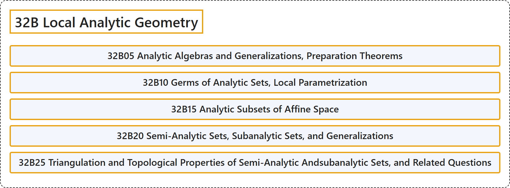

# 32B Local Analytic Geometry

## Classification

## Glossary

| Term | Definition | 中文翻译 | Source |
|---|---|---|---|
| **32B Local Analytic Geometry** 局部解析几何 | (No definition) | （无定义） | [Associate Editors of Mathematical Reviews and zbMATH, 2020](https://msc2020.org/) |
| **32B05 Analytic Algebras and Generalizations, Preparation Theorems** 解析代数及其推广、预备定理 | (No definition) | （无定义） | [Associate Editors of Mathematical Reviews and zbMATH, 2020](https://msc2020.org/) |
| **32B10 Germs of Analytic Sets, Local Parametrization** 解析集的芽、局部参数化 | (No definition) | （无定义） | [Associate Editors of Mathematical Reviews and zbMATH, 2020](https://msc2020.org/) |
| **32B15 Analytic Subsets of Affine Space** 仿射空间的解析子集 | (No definition) | （无定义） | [Associate Editors of Mathematical Reviews and zbMATH, 2020](https://msc2020.org/) |
| **32B20 Semi-Analytic Sets, Subanalytic Sets, and Generalizations** 半解析集、次解析集及其推广 | (No definition) | （无定义） | [Associate Editors of Mathematical Reviews and zbMATH, 2020](https://msc2020.org/) |
| **32B25 Triangulation and Topological Properties of Semi-Analytic Andsubanalytic Sets, and Related Questions** 半解析集与次解析集的三角剖分与拓扑性质及相关问题 | (No definition) | （无定义） | [Associate Editors of Mathematical Reviews and zbMATH, 2020](https://msc2020.org/) |

## References

Associate Editors of Mathematical Reviews and zbMATH. (2020). *MSC2020: Mathematics Subject Classification system*. Retrieved October 27, 2026, from <https://msc2020.org/>
