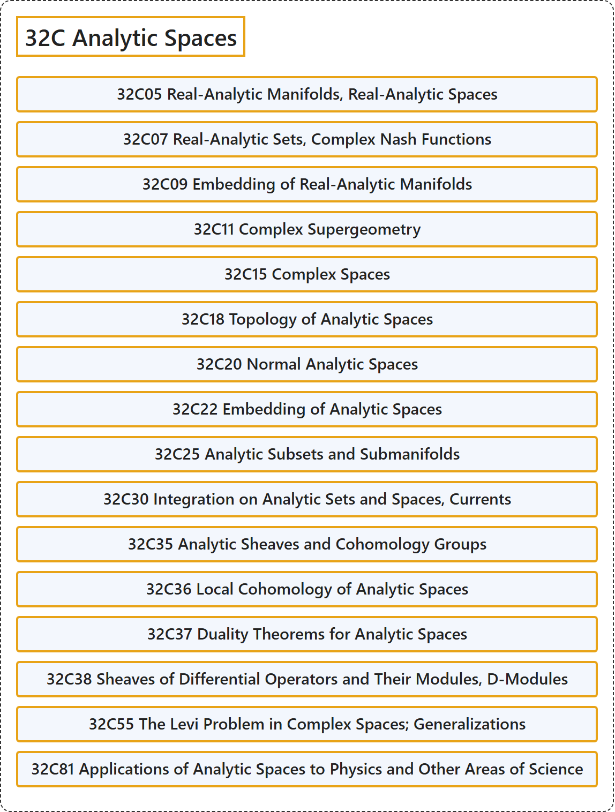

# 32C Analytic Spaces

## Classification

## Glossary

| Term | Definition | 中文翻译 | Source |
|---|---|---|---|
| **32C Analytic Spaces** 解析空间 | (No definition) | （无定义） | [Associate Editors of Mathematical Reviews and zbMATH, 2020](https://msc2020.org/) |
| **32C05 Real-Analytic Manifolds, Real-Analytic Spaces** 实解析流形、实解析空间 | (No definition) | （无定义） | [Associate Editors of Mathematical Reviews and zbMATH, 2020](https://msc2020.org/) |
| **32C07 Real-Analytic Sets, Complex Nash Functions** 实解析集、复纳什函数 | (No definition) | （无定义） | [Associate Editors of Mathematical Reviews and zbMATH, 2020](https://msc2020.org/) |
| **32C09 Embedding of Real-Analytic Manifolds** 实解析流形的嵌入 | (No definition) | （无定义） | [Associate Editors of Mathematical Reviews and zbMATH, 2020](https://msc2020.org/) |
| **32C11 Complex Supergeometry** 复超几何 | (No definition) | （无定义） | [Associate Editors of Mathematical Reviews and zbMATH, 2020](https://msc2020.org/) |
| **32C15 Complex Spaces** 复空间 | (No definition) | （无定义） | [Associate Editors of Mathematical Reviews and zbMATH, 2020](https://msc2020.org/) |
| **32C18 Topology of Analytic Spaces** 解析空间的拓扑 | (No definition) | （无定义） | [Associate Editors of Mathematical Reviews and zbMATH, 2020](https://msc2020.org/) |
| **32C20 Normal Analytic Spaces** 正规解析空间 | (No definition) | （无定义） | [Associate Editors of Mathematical Reviews and zbMATH, 2020](https://msc2020.org/) |
| **32C22 Embedding of Analytic Spaces** 解析空间的嵌入 | (No definition) | （无定义） | [Associate Editors of Mathematical Reviews and zbMATH, 2020](https://msc2020.org/) |
| **32C25 Analytic Subsets and Submanifolds** 解析子集与子流形 | (No definition) | （无定义） | [Associate Editors of Mathematical Reviews and zbMATH, 2020](https://msc2020.org/) |
| **32C30 Integration on Analytic Sets and Spaces, Currents** 解析集与解析空间上的积分、流 | (No definition) | （无定义） | [Associate Editors of Mathematical Reviews and zbMATH, 2020](https://msc2020.org/) |
| **32C35 Analytic Sheaves and Cohomology Groups** 解析层与上同调群 | (No definition) | （无定义） | [Associate Editors of Mathematical Reviews and zbMATH, 2020](https://msc2020.org/) |
| **32C36 Local Cohomology of Analytic Spaces** 解析空间的局部上同调 | (No definition) | （无定义） | [Associate Editors of Mathematical Reviews and zbMATH, 2020](https://msc2020.org/) |
| **32C37 Duality Theorems for Analytic Spaces** 解析空间的对偶定理 | (No definition) | （无定义） | [Associate Editors of Mathematical Reviews and zbMATH, 2020](https://msc2020.org/) |
| **32C38 Sheaves of Differential Operators and Their Modules, D-Modules** 微分算子层及其模、D模 | (No definition) | （无定义） | [Associate Editors of Mathematical Reviews and zbMATH, 2020](https://msc2020.org/) |
| **32C55 The Levi Problem in Complex Spaces; Generalizations** 复空间中的莱维问题；推广 | (No definition) | （无定义） | [Associate Editors of Mathematical Reviews and zbMATH, 2020](https://msc2020.org/) |
| **32C81 Applications of Analytic Spaces to Physics and Other Areas of Science** 解析空间在物理学及其他科学领域中的应用 | (No definition) | （无定义） | [Associate Editors of Mathematical Reviews and zbMATH, 2020](https://msc2020.org/) |

## References

Associate Editors of Mathematical Reviews and zbMATH. (2020). *MSC2020: Mathematics Subject Classification system*. Retrieved October 27, 2026, from <https://msc2020.org/>
