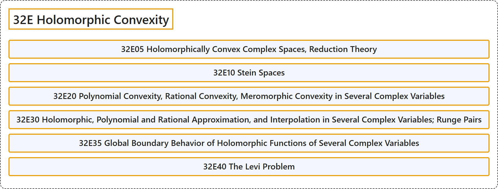

# 32E Holomorphic Convexity

## Classification

## Glossary

| Term | Definition | 中文翻译 | Source |
|---|---|---|---|
| **32E Holomorphic Convexity** 全纯凸性 | (No definition) | （无定义） | [Associate Editors of Mathematical Reviews and zbMATH, 2020](https://msc2020.org/) |
| **32E05 Holomorphically Convex Complex Spaces, Reduction Theory** 全纯凸复空间、约化理论 | (No definition) | （无定义） | [Associate Editors of Mathematical Reviews and zbMATH, 2020](https://msc2020.org/) |
| **32E10 Stein Spaces** 施泰因空间 | (No definition) | （无定义） | [Associate Editors of Mathematical Reviews and zbMATH, 2020](https://msc2020.org/) |
| **32E20 Polynomial Convexity, Rational Convexity, Meromorphic Convexity in Several Complex Variables** 多复变量中的多项式凸性、有理凸性、亚纯凸性 | (No definition) | （无定义） | [Associate Editors of Mathematical Reviews and zbMATH, 2020](https://msc2020.org/) |
| **32E30 Holomorphic, Polynomial and Rational Approximation, and Interpolation in Several Complex Variables; Runge Pairs** 多复变量中的全纯、多项式与有理逼近及插值；龙格对 | (No definition) | （无定义） | [Associate Editors of Mathematical Reviews and zbMATH, 2020](https://msc2020.org/) |
| **32E35 Global Boundary Behavior of Holomorphic Functions of Several Complex Variables** 多复变量全纯函数的整体边界性态 | (No definition) | （无定义） | [Associate Editors of Mathematical Reviews and zbMATH, 2020](https://msc2020.org/) |
| **32E40 The Levi Problem** 莱维问题 | (No definition) | （无定义） | [Associate Editors of Mathematical Reviews and zbMATH, 2020](https://msc2020.org/) |

## References

Associate Editors of Mathematical Reviews and zbMATH. (2020). *MSC2020: Mathematics Subject Classification system*. Retrieved October 27, 2026, from <https://msc2020.org/>
