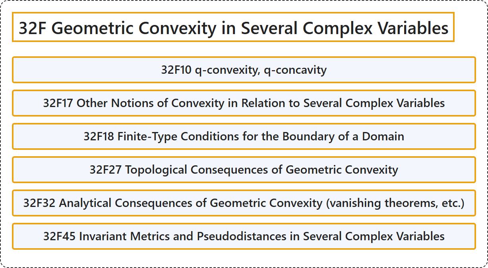

# 32F Geometric Convexity in Several Complex Variables

## Classification

## Glossary

| Term | Definition | 中文翻译 | Source |
|---|---|---|---|
| **32F Geometric Convexity in Several Complex Variables** 多复变中的几何凸性 | (No definition) | （无定义） | [Associate Editors of Mathematical Reviews and zbMATH, 2020](https://msc2020.org/) |
| **32F10 q-convexity, q-concavity** q凸性、q凹性 | (No definition) | （无定义） | [Associate Editors of Mathematical Reviews and zbMATH, 2020](https://msc2020.org/) |
| **32F17 Other Notions of Convexity in Relation to Several Complex Variables** 与多复变量相关的其他凸性概念 | (No definition) | （无定义） | [Associate Editors of Mathematical Reviews and zbMATH, 2020](https://msc2020.org/) |
| **32F18 Finite-Type Conditions for the Boundary of a Domain** 区域边界的有限型条件 | (No definition) | （无定义） | [Associate Editors of Mathematical Reviews and zbMATH, 2020](https://msc2020.org/) |
| **32F27 Topological Consequences of Geometric Convexity** 几何凸性的拓扑推论 | (No definition) | （无定义） | [Associate Editors of Mathematical Reviews and zbMATH, 2020](https://msc2020.org/) |
| **32F32 Analytical Consequences of Geometric Convexity (vanishing theorems, etc.)** 几何凸性的分析推论（消灭定理等） | (No definition) | （无定义） | [Associate Editors of Mathematical Reviews and zbMATH, 2020](https://msc2020.org/) |
| **32F45 Invariant Metrics and Pseudodistances in Several Complex Variables** 多复变量中的不变度量与伪距离 | (No definition) | （无定义） | [Associate Editors of Mathematical Reviews and zbMATH, 2020](https://msc2020.org/) |

## References

Associate Editors of Mathematical Reviews and zbMATH. (2020). *MSC2020: Mathematics Subject Classification system*. Retrieved October 27, 2026, from <https://msc2020.org/>
