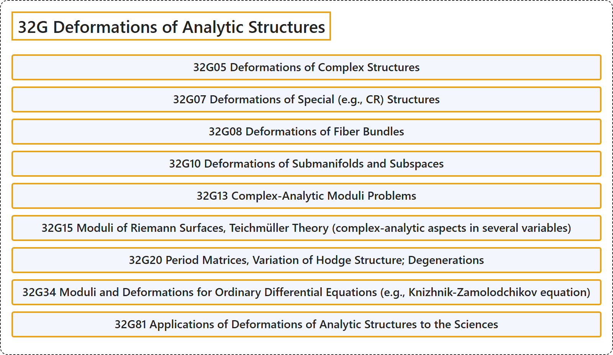

# 32G Deformations of Analytic Structures

## Classification

## Glossary

| Term | Definition | 中文翻译 | Source |
|---|---|---|---|
| **32G Deformations of Analytic Structures** 解析结构的形变 | (No definition) | （无定义） | [Associate Editors of Mathematical Reviews and zbMATH, 2020](https://msc2020.org/) |
| **32G05 Deformations of Complex Structures** 复结构的形变 | (No definition) | （无定义） | [Associate Editors of Mathematical Reviews and zbMATH, 2020](https://msc2020.org/) |
| **32G07 Deformations of Special (e.g., CR) Structures** 特殊（例如CR）结构的形变 | (No definition) | （无定义） | [Associate Editors of Mathematical Reviews and zbMATH, 2020](https://msc2020.org/) |
| **32G08 Deformations of Fiber Bundles** 纤维丛的形变 | (No definition) | （无定义） | [Associate Editors of Mathematical Reviews and zbMATH, 2020](https://msc2020.org/) |
| **32G10 Deformations of Submanifolds and Subspaces** 子流形与子空间的形变 | (No definition) | （无定义） | [Associate Editors of Mathematical Reviews and zbMATH, 2020](https://msc2020.org/) |
| **32G13 Complex-Analytic Moduli Problems** 复解析模问题 | (No definition) | （无定义） | [Associate Editors of Mathematical Reviews and zbMATH, 2020](https://msc2020.org/) |
| **32G15 Moduli of Riemann Surfaces, Teichmüller Theory (complex-analytic aspects in several variables)** 黎曼曲面的模、泰希米勒理论（多变量的复解析方面） | (No definition) | （无定义） | [Associate Editors of Mathematical Reviews and zbMATH, 2020](https://msc2020.org/) |
| **32G20 Period Matrices, Variation of Hodge Structure; Degenerations** 周期矩阵，霍奇结构的变分；退化 | (No definition) | （无定义） | [Associate Editors of Mathematical Reviews and zbMATH, 2020](https://msc2020.org/) |
| **32G34 Moduli and Deformations for Ordinary Differential Equations (e.g., Knizhnik-Zamolodchikov equation)** 常微分方程的模与形变（例如克尼日尼克-扎莫洛奇科夫方程） | (No definition) | （无定义） | [Associate Editors of Mathematical Reviews and zbMATH, 2020](https://msc2020.org/) |
| **32G81 Applications of Deformations of Analytic Structures to the Sciences** 解析结构形变在科学中的应用 | (No definition) | （无定义） | [Associate Editors of Mathematical Reviews and zbMATH, 2020](https://msc2020.org/) |

## References

Associate Editors of Mathematical Reviews and zbMATH. (2020). *MSC2020: Mathematics Subject Classification system*. Retrieved October 27, 2026, from <https://msc2020.org/>
