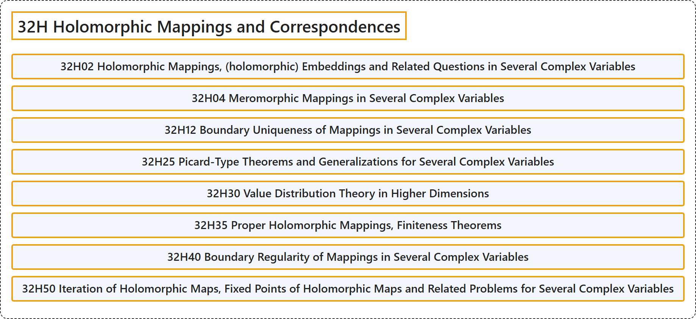

# 32H Holomorphic Mappings and Correspondences

## Classification

## Glossary

| Term | Definition | 中文翻译 | Source |
|---|---|---|---|
| **32H Holomorphic Mappings and Correspondences** 全纯映射与对应 | (No definition) | （无定义） | [Associate Editors of Mathematical Reviews and zbMATH, 2020](https://msc2020.org/) |
| **32H02 Holomorphic Mappings, (holomorphic) Embeddings and Related Questions in Several Complex Variables** 全纯映射、（全纯）嵌入及多复变数中的相关问题 | (No definition) | （无定义） | [Associate Editors of Mathematical Reviews and zbMATH, 2020](https://msc2020.org/) |
| **32H04 Meromorphic Mappings in Several Complex Variables** 多复变数中的亚纯映射 | (No definition) | （无定义） | [Associate Editors of Mathematical Reviews and zbMATH, 2020](https://msc2020.org/) |
| **32H12 Boundary Uniqueness of Mappings in Several Complex Variables** 多复变数中映射的边界唯一性 | (No definition) | （无定义） | [Associate Editors of Mathematical Reviews and zbMATH, 2020](https://msc2020.org/) |
| **32H25 Picard-Type Theorems and Generalizations for Several Complex Variables** 多复变数中的皮卡型定理及其推广 | (No definition) | （无定义） | [Associate Editors of Mathematical Reviews and zbMATH, 2020](https://msc2020.org/) |
| **32H30 Value Distribution Theory in Higher Dimensions** 高维值分布理论 | (No definition) | （无定义） | [Associate Editors of Mathematical Reviews and zbMATH, 2020](https://msc2020.org/) |
| **32H35 Proper Holomorphic Mappings, Finiteness Theorems** 真全纯映射，有限性定理 | (No definition) | （无定义） | [Associate Editors of Mathematical Reviews and zbMATH, 2020](https://msc2020.org/) |
| **32H40 Boundary Regularity of Mappings in Several Complex Variables** 多复变数中映射的边界正则性 | (No definition) | （无定义） | [Associate Editors of Mathematical Reviews and zbMATH, 2020](https://msc2020.org/) |
| **32H50 Iteration of Holomorphic Maps, Fixed Points of Holomorphic Maps and Related Problems for Several Complex Variables** 全纯映射的迭代，全纯映射的不动点及多复变数中的相关问题 | (No definition) | （无定义） | [Associate Editors of Mathematical Reviews and zbMATH, 2020](https://msc2020.org/) |

## References

Associate Editors of Mathematical Reviews and zbMATH. (2020). *MSC2020: Mathematics Subject Classification system*. Retrieved October 27, 2026, from <https://msc2020.org/>
