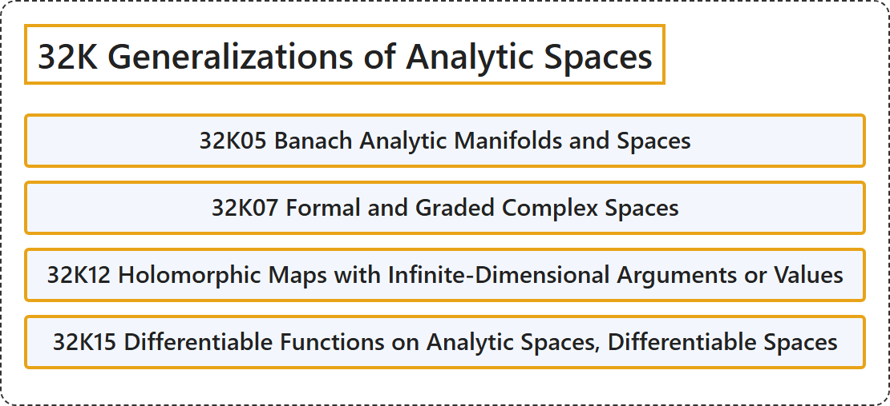

# 32K Generalizations of Analytic Spaces

## Classification

## Glossary

| Term | Definition | 中文翻译 | Source |
|---|---|---|---|
| **32K Generalizations of Analytic Spaces** 解析空间的推广 | (No definition) | （无定义） | [Associate Editors of Mathematical Reviews and zbMATH, 2020](https://msc2020.org/) |
| **32K05 Banach Analytic Manifolds and Spaces** 巴拿赫解析流形与空间 | (No definition) | （无定义） | [Associate Editors of Mathematical Reviews and zbMATH, 2020](https://msc2020.org/) |
| **32K07 Formal and Graded Complex Spaces** 形式复空间与分次复空间 | (No definition) | （无定义） | [Associate Editors of Mathematical Reviews and zbMATH, 2020](https://msc2020.org/) |
| **32K12 Holomorphic Maps with Infinite-Dimensional Arguments or Values** 具有无穷维自变量或取值的全纯映射 | (No definition) | （无定义） | [Associate Editors of Mathematical Reviews and zbMATH, 2020](https://msc2020.org/) |
| **32K15 Differentiable Functions on Analytic Spaces, Differentiable Spaces** 解析空间上的可微函数，可微空间 | (No definition) | （无定义） | [Associate Editors of Mathematical Reviews and zbMATH, 2020](https://msc2020.org/) |

## References

Associate Editors of Mathematical Reviews and zbMATH. (2020). *MSC2020: Mathematics Subject Classification system*. Retrieved October 27, 2026, from <https://msc2020.org/>
