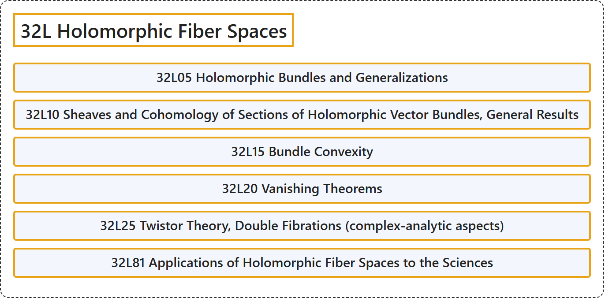

# 32L Holomorphic Fiber Spaces

## Classification

## Glossary

| Term | Definition | 中文翻译 | Source |
|---|---|---|---|
| **32L Holomorphic Fiber Spaces** 全纯纤维空间 | (No definition) | （无定义） | [Associate Editors of Mathematical Reviews and zbMATH, 2020](https://msc2020.org/) |
| **32L05 Holomorphic Bundles and Generalizations** 全纯丛及其推广 | (No definition) | （无定义） | [Associate Editors of Mathematical Reviews and zbMATH, 2020](https://msc2020.org/) |
| **32L10 Sheaves and Cohomology of Sections of Holomorphic Vector Bundles, General Results** 全纯向量丛截面的层与上同调，一般结果 | (No definition) | （无定义） | [Associate Editors of Mathematical Reviews and zbMATH, 2020](https://msc2020.org/) |
| **32L15 Bundle Convexity** 丛凸性 | (No definition) | （无定义） | [Associate Editors of Mathematical Reviews and zbMATH, 2020](https://msc2020.org/) |
| **32L20 Vanishing Theorems** 消失定理 | (No definition) | （无定义） | [Associate Editors of Mathematical Reviews and zbMATH, 2020](https://msc2020.org/) |
| **32L25 Twistor Theory, Double Fibrations (complex-analytic aspects)** 扭量理论，双纤维化（复解析方面） | (No definition) | （无定义） | [Associate Editors of Mathematical Reviews and zbMATH, 2020](https://msc2020.org/) |
| **32L81 Applications of Holomorphic Fiber Spaces to the Sciences** 全纯纤维空间在科学中的应用 | (No definition) | （无定义） | [Associate Editors of Mathematical Reviews and zbMATH, 2020](https://msc2020.org/) |

## References

Associate Editors of Mathematical Reviews and zbMATH. (2020). *MSC2020: Mathematics Subject Classification system*. Retrieved October 27, 2026, from <https://msc2020.org/>
