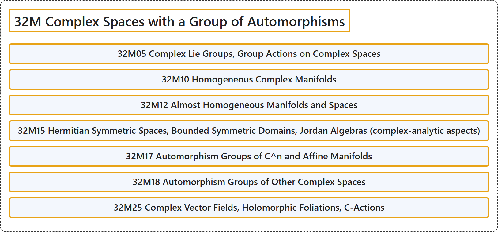

# 32M Complex Spaces with a Group of Automorphisms

## Classification

## Glossary

| Term | Definition | 中文翻译 | Source |
|---|---|---|---|
| **32M Complex Spaces with a Group of Automorphisms** 带自同构群的复空间 | (No definition) | （无定义） | [Associate Editors of Mathematical Reviews and zbMATH, 2020](https://msc2020.org/) |
| **32M05 Complex Lie Groups, Group Actions on Complex Spaces** 复李群，复空间上的群作用 | (No definition) | （无定义） | [Associate Editors of Mathematical Reviews and zbMATH, 2020](https://msc2020.org/) |
| **32M10 Homogeneous Complex Manifolds** 齐性复流形 | (No definition) | （无定义） | [Associate Editors of Mathematical Reviews and zbMATH, 2020](https://msc2020.org/) |
| **32M12 Almost Homogeneous Manifolds and Spaces** 几乎齐性流形与空间 | (No definition) | （无定义） | [Associate Editors of Mathematical Reviews and zbMATH, 2020](https://msc2020.org/) |
| **32M15 Hermitian Symmetric Spaces, Bounded Symmetric Domains, Jordan Algebras (complex-analytic aspects)** 埃尔米特对称空间，有界对称域，若尔当代数（复解析方面） | (No definition) | （无定义） | [Associate Editors of Mathematical Reviews and zbMATH, 2020](https://msc2020.org/) |
| **32M17 Automorphism Groups of C^n and Affine Manifolds** C^n 与仿射流形的自同构群 | (No definition) | （无定义） | [Associate Editors of Mathematical Reviews and zbMATH, 2020](https://msc2020.org/) |
| **32M18 Automorphism Groups of Other Complex Spaces** 其他复空间的自同构群 | (No definition) | （无定义） | [Associate Editors of Mathematical Reviews and zbMATH, 2020](https://msc2020.org/) |
| **32M25 Complex Vector Fields, Holomorphic Foliations, C-Actions** 复向量场，全纯叶状结构，C 作用 | (No definition) | （无定义） | [Associate Editors of Mathematical Reviews and zbMATH, 2020](https://msc2020.org/) |

## References

Associate Editors of Mathematical Reviews and zbMATH. (2020). *MSC2020: Mathematics Subject Classification system*. Retrieved October 27, 2026, from <https://msc2020.org/>
