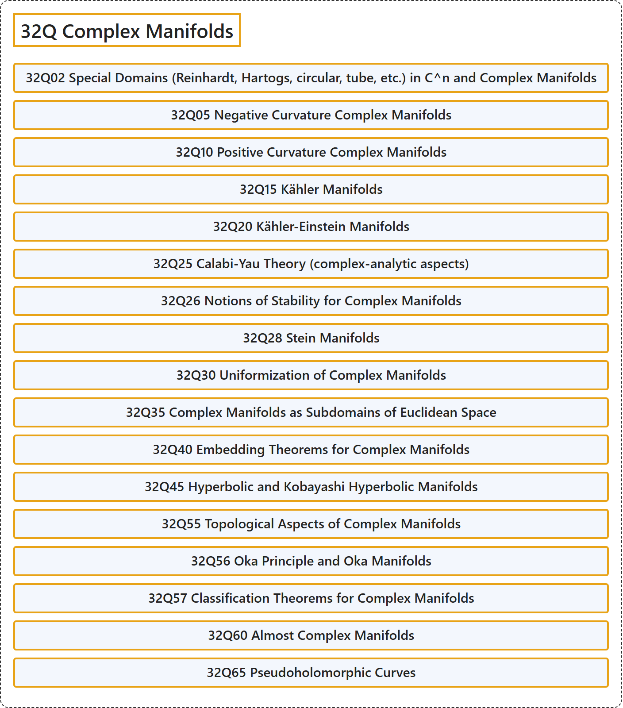

# 32Q Complex Manifolds

## Classification

## Glossary

| Term | Definition | 中文翻译 | Source |
|---|---|---|---|
| **32Q Complex Manifolds** 复流形 | (No definition) | （无定义） | [Associate Editors of Mathematical Reviews and zbMATH, 2020](https://msc2020.org/) |
| **32Q02 Special Domains (Reinhardt, Hartogs, circular, tube, etc.) in C^n and Complex Manifolds** C^n 与复流形中的特殊域（赖因哈特域、哈托格斯域、圆形域、管状域等） | (No definition) | （无定义） | [Associate Editors of Mathematical Reviews and zbMATH, 2020](https://msc2020.org/) |
| **32Q05 Negative Curvature Complex Manifolds** 负曲率复流形 | (No definition) | （无定义） | [Associate Editors of Mathematical Reviews and zbMATH, 2020](https://msc2020.org/) |
| **32Q10 Positive Curvature Complex Manifolds** 正曲率复流形 | (No definition) | （无定义） | [Associate Editors of Mathematical Reviews and zbMATH, 2020](https://msc2020.org/) |
| **32Q15 Kähler Manifolds** 凯勒流形 | (No definition) | （无定义） | [Associate Editors of Mathematical Reviews and zbMATH, 2020](https://msc2020.org/) |
| **32Q20 Kähler-Einstein Manifolds** 凯勒-爱因斯坦流形 | (No definition) | （无定义） | [Associate Editors of Mathematical Reviews and zbMATH, 2020](https://msc2020.org/) |
| **32Q25 Calabi-Yau Theory (complex-analytic aspects)** 卡拉比-丘理论（复解析方面） | (No definition) | （无定义） | [Associate Editors of Mathematical Reviews and zbMATH, 2020](https://msc2020.org/) |
| **32Q26 Notions of Stability for Complex Manifolds** 复流形的稳定性概念 | (No definition) | （无定义） | [Associate Editors of Mathematical Reviews and zbMATH, 2020](https://msc2020.org/) |
| **32Q28 Stein Manifolds** 施泰因流形 | (No definition) | （无定义） | [Associate Editors of Mathematical Reviews and zbMATH, 2020](https://msc2020.org/) |
| **32Q30 Uniformization of Complex Manifolds** 复流形的单值化 | (No definition) | （无定义） | [Associate Editors of Mathematical Reviews and zbMATH, 2020](https://msc2020.org/) |
| **32Q35 Complex Manifolds as Subdomains of Euclidean Space** 作为欧几里得空间子域的复流形 | (No definition) | （无定义） | [Associate Editors of Mathematical Reviews and zbMATH, 2020](https://msc2020.org/) |
| **32Q40 Embedding Theorems for Complex Manifolds** 复流形的嵌入定理 | (No definition) | （无定义） | [Associate Editors of Mathematical Reviews and zbMATH, 2020](https://msc2020.org/) |
| **32Q45 Hyperbolic and Kobayashi Hyperbolic Manifolds** 双曲流形与小林双曲流形 | (No definition) | （无定义） | [Associate Editors of Mathematical Reviews and zbMATH, 2020](https://msc2020.org/) |
| **32Q55 Topological Aspects of Complex Manifolds** 复流形的拓扑方面 | (No definition) | （无定义） | [Associate Editors of Mathematical Reviews and zbMATH, 2020](https://msc2020.org/) |
| **32Q56 Oka Principle and Oka Manifolds** 冈原理与冈流形 | (No definition) | （无定义） | [Associate Editors of Mathematical Reviews and zbMATH, 2020](https://msc2020.org/) |
| **32Q57 Classification Theorems for Complex Manifolds** 复流形的分类定理 | (No definition) | （无定义） | [Associate Editors of Mathematical Reviews and zbMATH, 2020](https://msc2020.org/) |
| **32Q60 Almost Complex Manifolds** 几乎复流形 | (No definition) | （无定义） | [Associate Editors of Mathematical Reviews and zbMATH, 2020](https://msc2020.org/) |
| **32Q65 Pseudoholomorphic Curves** 伪全纯曲线 | (No definition) | （无定义） | [Associate Editors of Mathematical Reviews and zbMATH, 2020](https://msc2020.org/) |

## References

Associate Editors of Mathematical Reviews and zbMATH. (2020). *MSC2020: Mathematics Subject Classification system*. Retrieved October 27, 2026, from <https://msc2020.org/>
