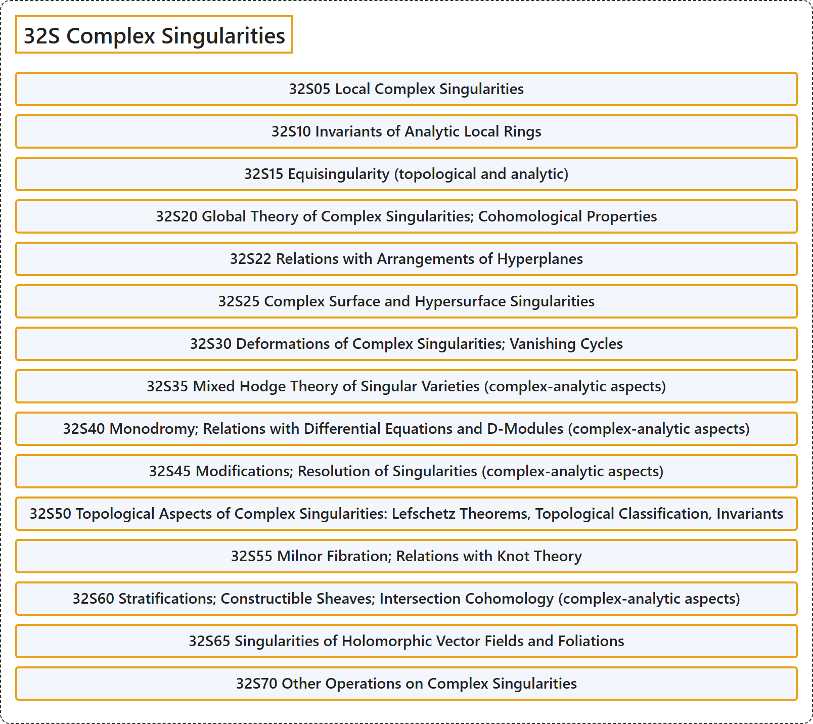

# 32S Complex Singularities

## Classification

## Glossary

| Term | Definition | 中文翻译 | Source |
|---|---|---|---|
| **32S Complex Singularities** 复奇点 | (No definition) | （无定义） | [Associate Editors of Mathematical Reviews and zbMATH, 2020](https://msc2020.org/) |
| **32S05 Local Complex Singularities** 局部复奇点 | (No definition) | （无定义） | [Associate Editors of Mathematical Reviews and zbMATH, 2020](https://msc2020.org/) |
| **32S10 Invariants of Analytic Local Rings** 解析局部环的不变量 | (No definition) | （无定义） | [Associate Editors of Mathematical Reviews and zbMATH, 2020](https://msc2020.org/) |
| **32S15 Equisingularity (topological and analytic)** 等奇异性（拓扑的与解析的） | (No definition) | （无定义） | [Associate Editors of Mathematical Reviews and zbMATH, 2020](https://msc2020.org/) |
| **32S20 Global Theory of Complex Singularities; Cohomological Properties** 复奇点的整体理论；上同调性质 | (No definition) | （无定义） | [Associate Editors of Mathematical Reviews and zbMATH, 2020](https://msc2020.org/) |
| **32S22 Relations with Arrangements of Hyperplanes** 与超平面配置的关系 | (No definition) | （无定义） | [Associate Editors of Mathematical Reviews and zbMATH, 2020](https://msc2020.org/) |
| **32S25 Complex Surface and Hypersurface Singularities** 复曲面奇点与超曲面奇点 | (No definition) | （无定义） | [Associate Editors of Mathematical Reviews and zbMATH, 2020](https://msc2020.org/) |
| **32S30 Deformations of Complex Singularities; Vanishing Cycles** 复奇点的形变；消失圈 | (No definition) | （无定义） | [Associate Editors of Mathematical Reviews and zbMATH, 2020](https://msc2020.org/) |
| **32S35 Mixed Hodge Theory of Singular Varieties (complex-analytic aspects)** 奇异簇的混合霍奇理论（复解析方面） | (No definition) | （无定义） | [Associate Editors of Mathematical Reviews and zbMATH, 2020](https://msc2020.org/) |
| **32S40 Monodromy; Relations with Differential Equations and D-Modules (complex-analytic aspects)** 单值性；与微分方程及 D 模的关系（复解析方面） | (No definition) | （无定义） | [Associate Editors of Mathematical Reviews and zbMATH, 2020](https://msc2020.org/) |
| **32S45 Modifications; Resolution of Singularities (complex-analytic aspects)** 修正；奇点解消（复解析方面） | (No definition) | （无定义） | [Associate Editors of Mathematical Reviews and zbMATH, 2020](https://msc2020.org/) |
| **32S50 Topological Aspects of Complex Singularities: Lefschetz Theorems, Topological Classification, Invariants** 复奇点的拓扑方面：莱夫谢茨定理，拓扑分类，不变量 | (No definition) | （无定义） | [Associate Editors of Mathematical Reviews and zbMATH, 2020](https://msc2020.org/) |
| **32S55 Milnor Fibration; Relations with Knot Theory** 米尔诺纤维化；与纽结理论的关系 | (No definition) | （无定义） | [Associate Editors of Mathematical Reviews and zbMATH, 2020](https://msc2020.org/) |
| **32S60 Stratifications; Constructible Sheaves; Intersection Cohomology (complex-analytic aspects)** 分层；可构造层；相交上同调（复解析方面） | (No definition) | （无定义） | [Associate Editors of Mathematical Reviews and zbMATH, 2020](https://msc2020.org/) |
| **32S65 Singularities of Holomorphic Vector Fields and Foliations** 全纯向量场与叶状结构的奇点 | (No definition) | （无定义） | [Associate Editors of Mathematical Reviews and zbMATH, 2020](https://msc2020.org/) |
| **32S70 Other Operations on Complex Singularities** 复奇点上的其他运算 | (No definition) | （无定义） | [Associate Editors of Mathematical Reviews and zbMATH, 2020](https://msc2020.org/) |

## References

Associate Editors of Mathematical Reviews and zbMATH. (2020). *MSC2020: Mathematics Subject Classification system*. Retrieved October 27, 2026, from <https://msc2020.org/>
