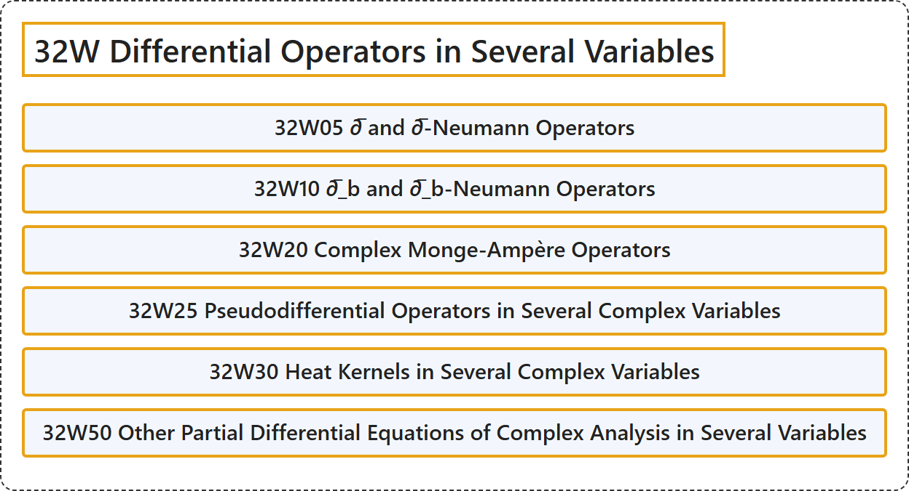

# 32W Differential Operators in Several Variables

## Classification

## Glossary

| Term | Definition | 中文翻译 | Source |
|---|---|---|---|
| **32W Differential Operators in Several Variables** 多变量微分算子 | (No definition) | （无定义） | [Associate Editors of Mathematical Reviews and zbMATH, 2020](https://msc2020.org/) |
| **32W05 ∂̅ and ∂̅-Neumann Operators** ∂̅ 与 ∂̅-诺伊曼算子 | (No definition) | （无定义） | [Associate Editors of Mathematical Reviews and zbMATH, 2020](https://msc2020.org/) |
| **32W10 ∂̅_b and ∂̅_b-Neumann Operators** ∂̅_b 与 ∂̅_b-诺伊曼算子 | (No definition) | （无定义） | [Associate Editors of Mathematical Reviews and zbMATH, 2020](https://msc2020.org/) |
| **32W20 Complex Monge-Ampère Operators** 复蒙日-安培算子 | (No definition) | （无定义） | [Associate Editors of Mathematical Reviews and zbMATH, 2020](https://msc2020.org/) |
| **32W25 Pseudodifferential Operators in Several Complex Variables** 多复变数中的伪微分算子 | (No definition) | （无定义） | [Associate Editors of Mathematical Reviews and zbMATH, 2020](https://msc2020.org/) |
| **32W30 Heat Kernels in Several Complex Variables** 多复变数中的热核 | (No definition) | （无定义） | [Associate Editors of Mathematical Reviews and zbMATH, 2020](https://msc2020.org/) |
| **32W50 Other Partial Differential Equations of Complex Analysis in Several Variables** 多复变数复分析中的其他偏微分方程 | (No definition) | （无定义） | [Associate Editors of Mathematical Reviews and zbMATH, 2020](https://msc2020.org/) |

## References

Associate Editors of Mathematical Reviews and zbMATH. (2020). *MSC2020: Mathematics Subject Classification system*. Retrieved October 27, 2026, from <https://msc2020.org/>
