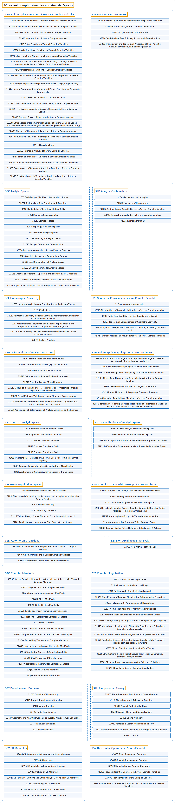

# 32 Several Complex Variables and Analytic Spaces

## Classification

## Glossary

| Term | Definition | 中文翻译 | Source |
|---|---|---|---|
| **32 Several Complex Variables and Analytic Spaces** 多复变与解析空间 | (context) "Complex analysis is the study of **complex numbers together with their derivatives**, manipulation, and other properties." | （语境）复分析研究**复数及其导数**、运算和其他性质。 | [Weisstein, n.d., "Complex analysis" entry, para. 1](https://mathworld.wolfram.com/ComplexAnalysis.html#:~:text=Complex%20analysis%20is%20the%20study%20of%20complex%20numbers) |
| **[32A Holomorphic Functions of Several Complex Variables](32a-holomorphic-functions-of-several-complex-variables.md)** 多复变全纯函数 | (No definition) | （无定义） | [Associate Editors of Mathematical Reviews and zbMATH, 2020](https://msc2020.org/) |
| **[32B Local Analytic Geometry](32b-local-analytic-geometry.md)** 局部解析几何 | (No definition) | （无定义） | [Associate Editors of Mathematical Reviews and zbMATH, 2020](https://msc2020.org/) |
| **[32C Analytic Spaces](32c-analytic-spaces.md)** 解析空间 | (No definition) | （无定义） | [Associate Editors of Mathematical Reviews and zbMATH, 2020](https://msc2020.org/) |
| **[32D Analytic Continuation](32d-analytic-continuation.md)** 解析延拓 | (No definition) | （无定义） | [Associate Editors of Mathematical Reviews and zbMATH, 2020](https://msc2020.org/) |
| **[32E Holomorphic Convexity](32e-holomorphic-convexity.md)** 全纯凸性 | (No definition) | （无定义） | [Associate Editors of Mathematical Reviews and zbMATH, 2020](https://msc2020.org/) |
| **[32F Geometric Convexity in Several Complex Variables](32f-geometric-convexity-in-several-complex-variables.md)** 多复变中的几何凸性 | (No definition) | （无定义） | [Associate Editors of Mathematical Reviews and zbMATH, 2020](https://msc2020.org/) |
| **[32G Deformations of Analytic Structures](32g-deformations-of-analytic-structures.md)** 解析结构的形变 | (No definition) | （无定义） | [Associate Editors of Mathematical Reviews and zbMATH, 2020](https://msc2020.org/) |
| **[32H Holomorphic Mappings and Correspondences](32h-holomorphic-mappings-and-correspondences.md)** 全纯映射与对应 | (No definition) | （无定义） | [Associate Editors of Mathematical Reviews and zbMATH, 2020](https://msc2020.org/) |
| **[32J Compact Analytic Spaces](32j-compact-analytic-spaces.md)** 紧解析空间 | (No definition) | （无定义） | [Associate Editors of Mathematical Reviews and zbMATH, 2020](https://msc2020.org/) |
| **[32K Generalizations of Analytic Spaces](32k-generalizations-of-analytic-spaces.md)** 解析空间的推广 | (No definition) | （无定义） | [Associate Editors of Mathematical Reviews and zbMATH, 2020](https://msc2020.org/) |
| **[32L Holomorphic Fiber Spaces](32l-holomorphic-fiber-spaces.md)** 全纯纤维空间 | (No definition) | （无定义） | [Associate Editors of Mathematical Reviews and zbMATH, 2020](https://msc2020.org/) |
| **[32M Complex Spaces with a Group of Automorphisms](32m-complex-spaces-with-a-group-of-automorphisms.md)** 带自同构群的复空间 | (No definition) | （无定义） | [Associate Editors of Mathematical Reviews and zbMATH, 2020](https://msc2020.org/) |
| **[32N Automorphic Functions](32n-automorphic-functions.md)** 自守函数 | (No definition) | （无定义） | [Associate Editors of Mathematical Reviews and zbMATH, 2020](https://msc2020.org/) |
| **[32P Non-Archimedean Analysis](32p-non-archimedean-analysis.md)** 非阿基米德分析 | (No definition) | （无定义） | [Associate Editors of Mathematical Reviews and zbMATH, 2020](https://msc2020.org/) |
| **[32Q Complex Manifolds](32q-complex-manifolds.md)** 复流形 | (No definition) | （无定义） | [Associate Editors of Mathematical Reviews and zbMATH, 2020](https://msc2020.org/) |
| **[32S Complex Singularities](32s-complex-singularities.md)** 复奇点 | (No definition) | （无定义） | [Associate Editors of Mathematical Reviews and zbMATH, 2020](https://msc2020.org/) |
| **[32T Pseudoconvex Domains](32t-pseudoconvex-domains.md)** 伪凸域 | (No definition) | （无定义） | [Associate Editors of Mathematical Reviews and zbMATH, 2020](https://msc2020.org/) |
| **[32U Pluripotential Theory](32u-pluripotential-theory.md)** 多重位势论 | (No definition) | （无定义） | [Associate Editors of Mathematical Reviews and zbMATH, 2020](https://msc2020.org/) |
| **[32V CR Manifolds](32v-cr-manifolds.md)** CR 流形 | (No definition) | （无定义） | [Associate Editors of Mathematical Reviews and zbMATH, 2020](https://msc2020.org/) |
| **[32W Differential Operators in Several Variables](32w-differential-operators-in-several-variables.md)** 多变量微分算子 | (No definition) | （无定义） | [Associate Editors of Mathematical Reviews and zbMATH, 2020](https://msc2020.org/) |

## References

Associate Editors of Mathematical Reviews and zbMATH. (2020). *MSC2020: Mathematics Subject Classification system*. Retrieved October 27, 2026, from <https://msc2020.org/>

Weisstein, E. W. (n.d.). *Complex analysis*. MathWorld: A Wolfram Resource. Retrieved October 27, 2026, from <https://mathworld.wolfram.com/ComplexAnalysis.html>
