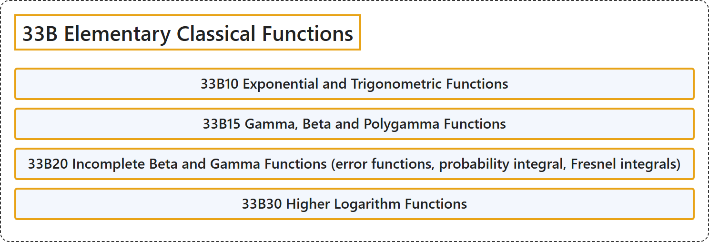

# 33B Elementary Classical Functions

## Classification

## Glossary

| Term | Definition | 中文翻译 | Source |
|---|---|---|---|
| **33B Elementary Classical Functions** 初等经典函数 | (No definition) | （无定义） | [Associate Editors of Mathematical Reviews and zbMATH, 2020](https://msc2020.org/) |
| **33B10 Exponential and Trigonometric Functions** 指数函数与三角函数 | (No definition) | （无定义） | [Associate Editors of Mathematical Reviews and zbMATH, 2020](https://msc2020.org/) |
| **33B15 Gamma, Beta and Polygamma Functions** 伽马函数、贝塔函数与多伽马函数 | (No definition) | （无定义） | [Associate Editors of Mathematical Reviews and zbMATH, 2020](https://msc2020.org/) |
| **33B20 Incomplete Beta and Gamma Functions (error functions, probability integral, Fresnel integrals)** 不完全贝塔函数与伽马函数（误差函数、概率积分、菲涅耳积分） | (No definition) | （无定义） | [Associate Editors of Mathematical Reviews and zbMATH, 2020](https://msc2020.org/) |
| **33B30 Higher Logarithm Functions** 高阶对数函数 | (No definition) | （无定义） | [Associate Editors of Mathematical Reviews and zbMATH, 2020](https://msc2020.org/) |

## References

Associate Editors of Mathematical Reviews and zbMATH. (2020). *MSC2020: Mathematics Subject Classification system*. Retrieved October 27, 2026, from <https://msc2020.org/>
