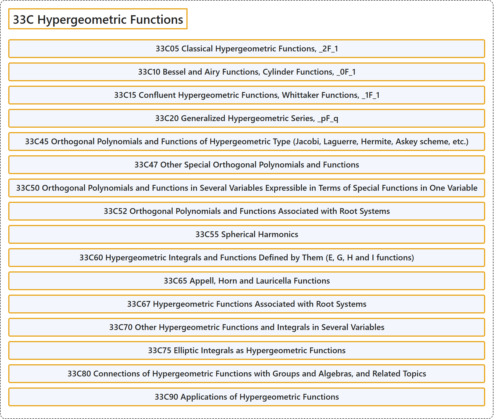

# 33C Hypergeometric Functions

## Classification

## Glossary

| Term | Definition | 中文翻译 | Source |
|---|---|---|---|
| **33C Hypergeometric Functions** 超几何函数 | (No definition) | （无定义） | [Associate Editors of Mathematical Reviews and zbMATH, 2020](https://msc2020.org/) |
| **33C05 Classical Hypergeometric Functions, _2F_1** 经典超几何函数，_2F_1 | (No definition) | （无定义） | [Associate Editors of Mathematical Reviews and zbMATH, 2020](https://msc2020.org/) |
| **33C10 Bessel and Airy Functions, Cylinder Functions, _0F_1** 贝塞尔函数与艾里函数，柱函数，_0F_1 | (No definition) | （无定义） | [Associate Editors of Mathematical Reviews and zbMATH, 2020](https://msc2020.org/) |
| **33C15 Confluent Hypergeometric Functions, Whittaker Functions, _1F_1** 合流超几何函数，惠特克函数，_1F_1 | (No definition) | （无定义） | [Associate Editors of Mathematical Reviews and zbMATH, 2020](https://msc2020.org/) |
| **33C20 Generalized Hypergeometric Series, _pF_q** 广义超几何级数，_pF_q | (No definition) | （无定义） | [Associate Editors of Mathematical Reviews and zbMATH, 2020](https://msc2020.org/) |
| **33C45 Orthogonal Polynomials and Functions of Hypergeometric Type (Jacobi, Laguerre, Hermite, Askey scheme, etc.)** 超几何型正交多项式与函数（雅可比、拉盖尔、埃尔米特、阿斯基格式等） | (No definition) | （无定义） | [Associate Editors of Mathematical Reviews and zbMATH, 2020](https://msc2020.org/) |
| **33C47 Other Special Orthogonal Polynomials and Functions** 其他特殊正交多项式与函数 | (No definition) | （无定义） | [Associate Editors of Mathematical Reviews and zbMATH, 2020](https://msc2020.org/) |
| **33C50 Orthogonal Polynomials and Functions in Several Variables Expressible in Terms of Special Functions in One Variable** 可用一元特殊函数表示的多元正交多项式与函数 | (No definition) | （无定义） | [Associate Editors of Mathematical Reviews and zbMATH, 2020](https://msc2020.org/) |
| **33C52 Orthogonal Polynomials and Functions Associated with Root Systems** 与根系相关的正交多项式与函数 | (No definition) | （无定义） | [Associate Editors of Mathematical Reviews and zbMATH, 2020](https://msc2020.org/) |
| **33C55 Spherical Harmonics** 球谐函数 | (No definition) | （无定义） | [Associate Editors of Mathematical Reviews and zbMATH, 2020](https://msc2020.org/) |
| **33C60 Hypergeometric Integrals and Functions Defined by Them (E, G, H and I functions)** 超几何积分及由其定义的函数（E、G、H 与 I 函数） | (No definition) | （无定义） | [Associate Editors of Mathematical Reviews and zbMATH, 2020](https://msc2020.org/) |
| **33C65 Appell, Horn and Lauricella Functions** 阿佩尔函数、霍恩函数与劳里切拉函数 | (No definition) | （无定义） | [Associate Editors of Mathematical Reviews and zbMATH, 2020](https://msc2020.org/) |
| **33C67 Hypergeometric Functions Associated with Root Systems** 与根系相关的超几何函数 | (No definition) | （无定义） | [Associate Editors of Mathematical Reviews and zbMATH, 2020](https://msc2020.org/) |
| **33C70 Other Hypergeometric Functions and Integrals in Several Variables** 其他多元超几何函数与积分 | (No definition) | （无定义） | [Associate Editors of Mathematical Reviews and zbMATH, 2020](https://msc2020.org/) |
| **33C75 Elliptic Integrals as Hypergeometric Functions** 作为超几何函数的椭圆积分 | (No definition) | （无定义） | [Associate Editors of Mathematical Reviews and zbMATH, 2020](https://msc2020.org/) |
| **33C80 Connections of Hypergeometric Functions with Groups and Algebras, and Related Topics** 超几何函数与群和代数的联系及相关主题 | (No definition) | （无定义） | [Associate Editors of Mathematical Reviews and zbMATH, 2020](https://msc2020.org/) |
| **33C90 Applications of Hypergeometric Functions** 超几何函数的应用 | (No definition) | （无定义） | [Associate Editors of Mathematical Reviews and zbMATH, 2020](https://msc2020.org/) |

## References

Associate Editors of Mathematical Reviews and zbMATH. (2020). *MSC2020: Mathematics Subject Classification system*. Retrieved October 27, 2026, from <https://msc2020.org/>
