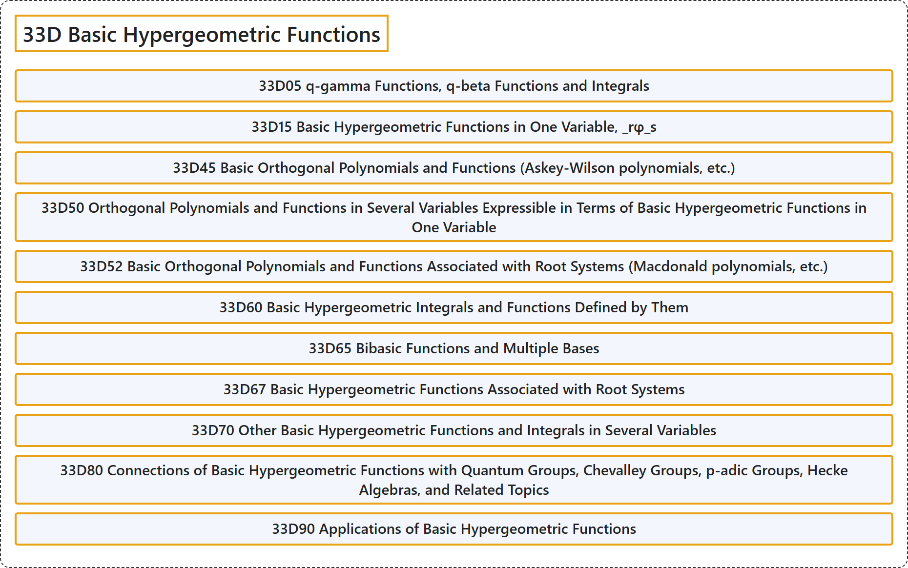

# 33D Basic Hypergeometric Functions

## Classification

## Glossary

| Term | Definition | 中文翻译 | Source |
|---|---|---|---|
| **33D Basic Hypergeometric Functions** 基本超几何函数 | (No definition) | （无定义） | [Associate Editors of Mathematical Reviews and zbMATH, 2020](https://msc2020.org/) |
| **33D05 q-gamma Functions, q-beta Functions and Integrals** q-伽马函数、q-贝塔函数与积分 | (No definition) | （无定义） | [Associate Editors of Mathematical Reviews and zbMATH, 2020](https://msc2020.org/) |
| **33D15 Basic Hypergeometric Functions in One Variable, _rφ_s** 一元基本超几何函数，_rφ_s | (No definition) | （无定义） | [Associate Editors of Mathematical Reviews and zbMATH, 2020](https://msc2020.org/) |
| **33D45 Basic Orthogonal Polynomials and Functions (Askey-Wilson polynomials, etc.)** 基本正交多项式与函数（阿斯基-威尔逊多项式等） | (No definition) | （无定义） | [Associate Editors of Mathematical Reviews and zbMATH, 2020](https://msc2020.org/) |
| **33D50 Orthogonal Polynomials and Functions in Several Variables Expressible in Terms of Basic Hypergeometric Functions in One Variable** 可用一元基本超几何函数表示的多元正交多项式与函数 | (No definition) | （无定义） | [Associate Editors of Mathematical Reviews and zbMATH, 2020](https://msc2020.org/) |
| **33D52 Basic Orthogonal Polynomials and Functions Associated with Root Systems (Macdonald polynomials, etc.)** 与根系相关的基本正交多项式与函数（麦克唐纳多项式等） | (No definition) | （无定义） | [Associate Editors of Mathematical Reviews and zbMATH, 2020](https://msc2020.org/) |
| **33D60 Basic Hypergeometric Integrals and Functions Defined by Them** 基本超几何积分及由其定义的函数 | (No definition) | （无定义） | [Associate Editors of Mathematical Reviews and zbMATH, 2020](https://msc2020.org/) |
| **33D65 Bibasic Functions and Multiple Bases** 双基函数与多重基 | (No definition) | （无定义） | [Associate Editors of Mathematical Reviews and zbMATH, 2020](https://msc2020.org/) |
| **33D67 Basic Hypergeometric Functions Associated with Root Systems** 与根系相关的基本超几何函数 | (No definition) | （无定义） | [Associate Editors of Mathematical Reviews and zbMATH, 2020](https://msc2020.org/) |
| **33D70 Other Basic Hypergeometric Functions and Integrals in Several Variables** 其他多元基本超几何函数与积分 | (No definition) | （无定义） | [Associate Editors of Mathematical Reviews and zbMATH, 2020](https://msc2020.org/) |
| **33D80 Connections of Basic Hypergeometric Functions with Quantum Groups, Chevalley Groups, p-adic Groups, Hecke Algebras, and Related Topics** 基本超几何函数与量子群、舍瓦莱群、p 进群、赫克代数的联系及相关主题 | (No definition) | （无定义） | [Associate Editors of Mathematical Reviews and zbMATH, 2020](https://msc2020.org/) |
| **33D90 Applications of Basic Hypergeometric Functions** 基本超几何函数的应用 | (No definition) | （无定义） | [Associate Editors of Mathematical Reviews and zbMATH, 2020](https://msc2020.org/) |

## References

Associate Editors of Mathematical Reviews and zbMATH. (2020). *MSC2020: Mathematics Subject Classification system*. Retrieved October 27, 2026, from <https://msc2020.org/>
