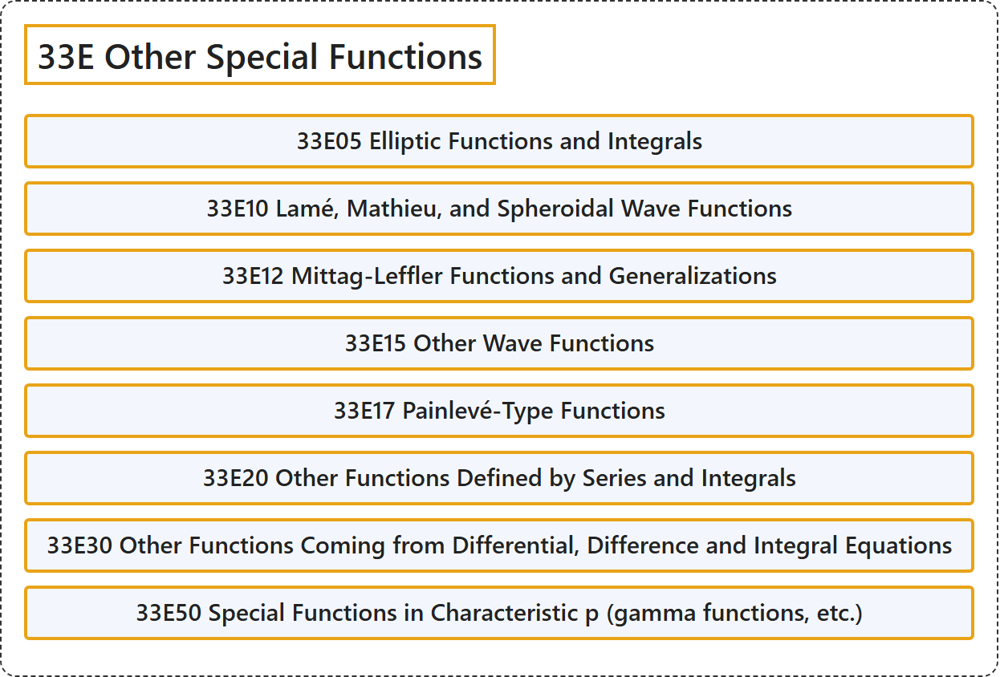

# 33E Other Special Functions

## Classification

## Glossary

| Term | Definition | 中文翻译 | Source |
|---|---|---|---|
| **33E Other Special Functions** 其他特殊函数 | (No definition) | （无定义） | [Associate Editors of Mathematical Reviews and zbMATH, 2020](https://msc2020.org/) |
| **33E05 Elliptic Functions and Integrals** 椭圆函数与椭圆积分 | (No definition) | （无定义） | [Associate Editors of Mathematical Reviews and zbMATH, 2020](https://msc2020.org/) |
| **33E10 Lamé, Mathieu, and Spheroidal Wave Functions** 拉梅函数、马蒂厄函数与椭球波函数 | (No definition) | （无定义） | [Associate Editors of Mathematical Reviews and zbMATH, 2020](https://msc2020.org/) |
| **33E12 Mittag-Leffler Functions and Generalizations** 米塔格-列夫勒函数及其推广 | (No definition) | （无定义） | [Associate Editors of Mathematical Reviews and zbMATH, 2020](https://msc2020.org/) |
| **33E15 Other Wave Functions** 其他波函数 | (No definition) | （无定义） | [Associate Editors of Mathematical Reviews and zbMATH, 2020](https://msc2020.org/) |
| **33E17 Painlevé-Type Functions** 潘勒韦型函数 | (No definition) | （无定义） | [Associate Editors of Mathematical Reviews and zbMATH, 2020](https://msc2020.org/) |
| **33E20 Other Functions Defined by Series and Integrals** 由级数与积分定义的其他函数 | (No definition) | （无定义） | [Associate Editors of Mathematical Reviews and zbMATH, 2020](https://msc2020.org/) |
| **33E30 Other Functions Coming from Differential, Difference and Integral Equations** 来自微分方程、差分方程与积分方程的其他函数 | (No definition) | （无定义） | [Associate Editors of Mathematical Reviews and zbMATH, 2020](https://msc2020.org/) |
| **33E50 Special Functions in Characteristic p (gamma functions, etc.)** 特征 p 中的特殊函数（伽马函数等） | (No definition) | （无定义） | [Associate Editors of Mathematical Reviews and zbMATH, 2020](https://msc2020.org/) |

## References

Associate Editors of Mathematical Reviews and zbMATH. (2020). *MSC2020: Mathematics Subject Classification system*. Retrieved October 27, 2026, from <https://msc2020.org/>
