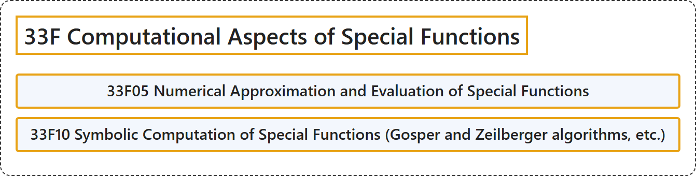

# 33F Computational Aspects of Special Functions

## Classification

## Glossary

| Term | Definition | 中文翻译 | Source |
|---|---|---|---|
| **33F Computational Aspects of Special Functions** 特殊函数的计算方面 | (No definition) | （无定义） | [Associate Editors of Mathematical Reviews and zbMATH, 2020](https://msc2020.org/) |
| **33F05 Numerical Approximation and Evaluation of Special Functions** 特殊函数的数值逼近与计算 | (No definition) | （无定义） | [Associate Editors of Mathematical Reviews and zbMATH, 2020](https://msc2020.org/) |
| **33F10 Symbolic Computation of Special Functions (Gosper and Zeilberger algorithms, etc.)** 特殊函数的符号计算（戈斯珀算法与泽尔贝格尔算法等） | (No definition) | （无定义） | [Associate Editors of Mathematical Reviews and zbMATH, 2020](https://msc2020.org/) |

## References

Associate Editors of Mathematical Reviews and zbMATH. (2020). *MSC2020: Mathematics Subject Classification system*. Retrieved October 27, 2026, from <https://msc2020.org/>
