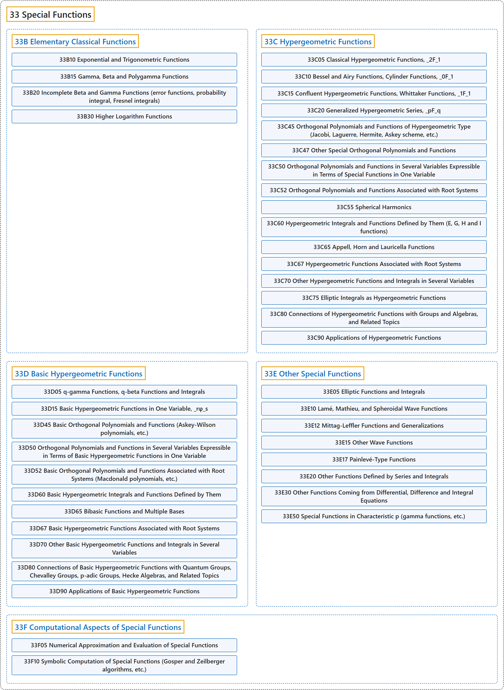

# 33 Special Functions

## Classification

## Glossary

| Term | Definition | 中文翻译 | Source |
|---|---|---|---|
| **33 Special Functions** 特殊函数 | "A special function is a function (usually named after an early investigator of its properties) having **a particular use in mathematical physics** or some other branch of mathematics." | 特殊函数是一种函数（通常以早期研究其性质的人命名），它**有特定的用途，用在数学物理**或其他数学分支中。 | [Weisstein, n.d., "Special function" entry, para. 1](https://mathworld.wolfram.com/SpecialFunction.html#:~:text=A%20special%20function%20is%20a%20function) |
| **[33B Elementary Classical Functions](33b-elementary-classical-functions.md)** 初等经典函数 | (No definition) | （无定义） | [Associate Editors of Mathematical Reviews and zbMATH, 2020](https://msc2020.org/) |
| **[33C Hypergeometric Functions](33c-hypergeometric-functions.md)** 超几何函数 | (No definition) | （无定义） | [Associate Editors of Mathematical Reviews and zbMATH, 2020](https://msc2020.org/) |
| **[33D Basic Hypergeometric Functions](33d-basic-hypergeometric-functions.md)** 基本超几何函数 | (No definition) | （无定义） | [Associate Editors of Mathematical Reviews and zbMATH, 2020](https://msc2020.org/) |
| **[33E Other Special Functions](33e-other-special-functions.md)** 其他特殊函数 | (No definition) | （无定义） | [Associate Editors of Mathematical Reviews and zbMATH, 2020](https://msc2020.org/) |
| **[33F Computational Aspects of Special Functions](33f-computational-aspects-of-special-functions.md)** 特殊函数的计算方面 | (No definition) | （无定义） | [Associate Editors of Mathematical Reviews and zbMATH, 2020](https://msc2020.org/) |

## References

Associate Editors of Mathematical Reviews and zbMATH. (2020). *MSC2020: Mathematics Subject Classification system*. Retrieved October 27, 2026, from <https://msc2020.org/>

Weisstein, E. W. (n.d.). *Special function*. MathWorld: A Wolfram Resource. Retrieved October 27, 2026, from <https://mathworld.wolfram.com/SpecialFunction.html>
